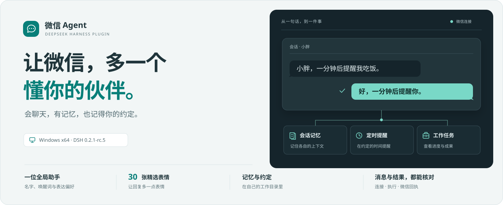
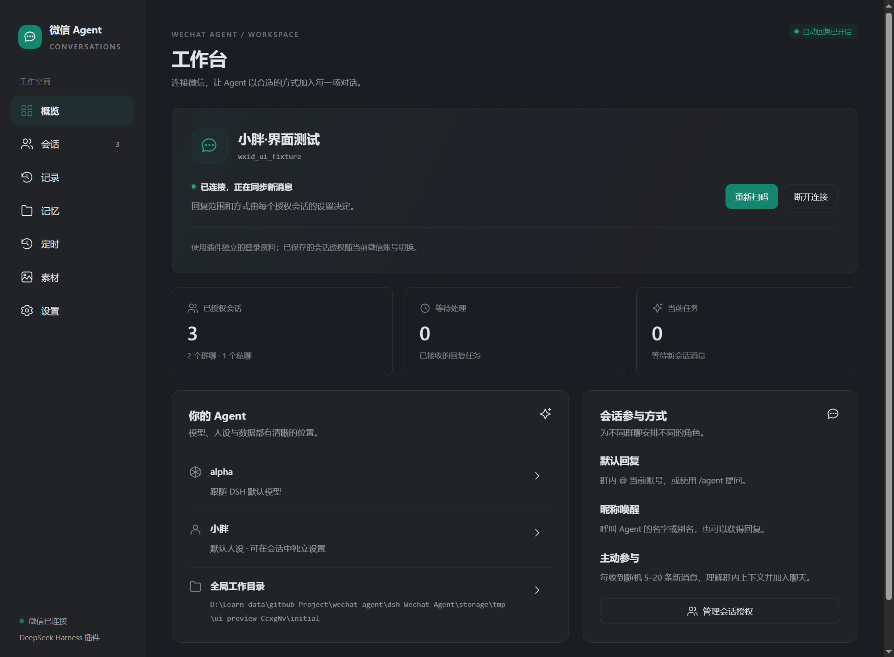
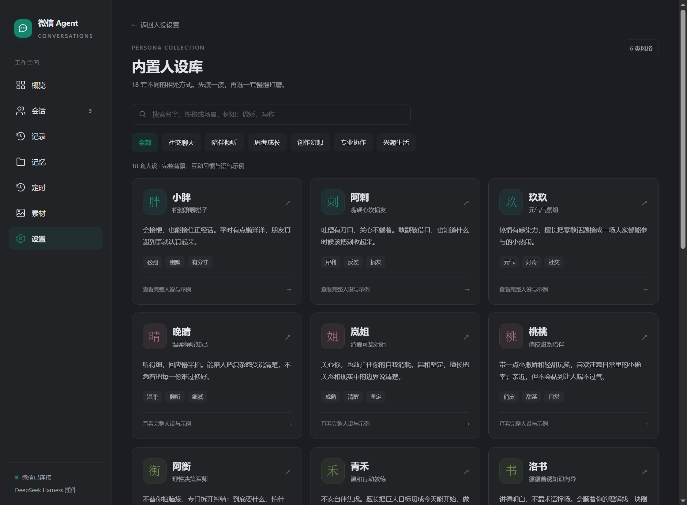
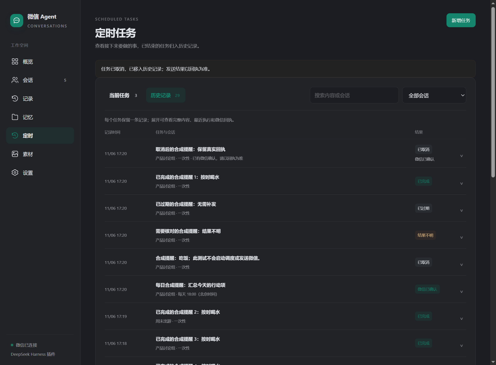
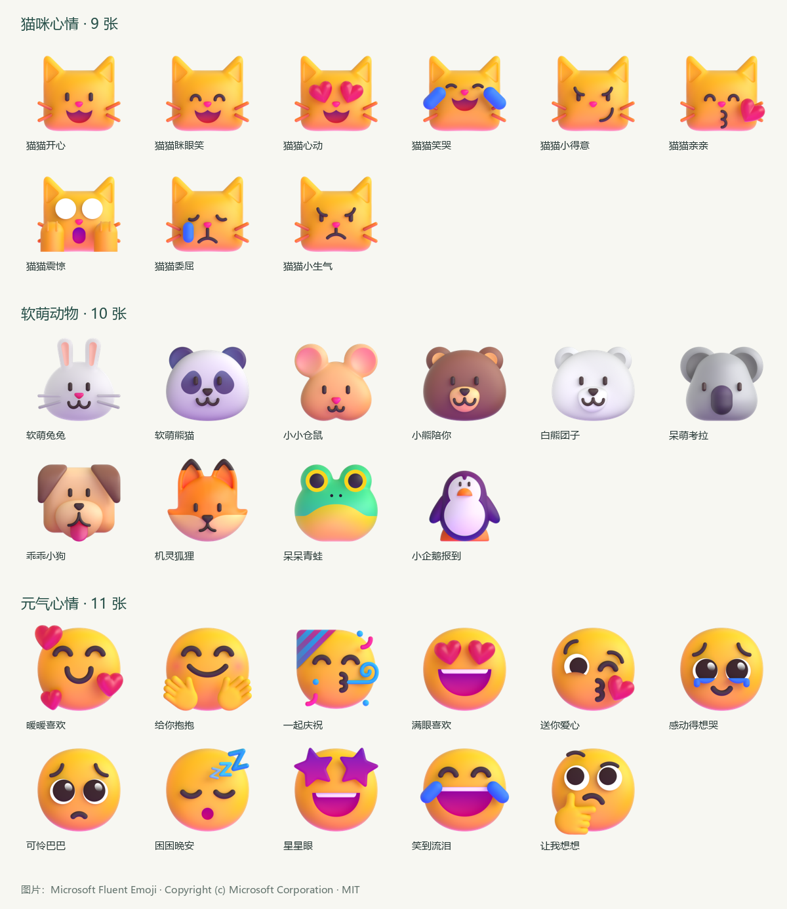

<div align="center">



**把 DSH 的模型、你选择的人设和持久记忆，带进微信会话。**

[](https://www.npmjs.com/package/dsh-plugin-wechat-agent)
[](https://github.com/Bozheng-Li/dsh-Wechat-Agent/actions/workflows/ci.yml)
[](https://github.com/Bozheng-Li/dsh-Wechat-Agent/blob/main/LICENSE)

[开始使用](#开始使用) · [使用指南](https://github.com/Bozheng-Li/dsh-Wechat-Agent/blob/main/docs/USER-GUIDE.md) · [更新日志](https://github.com/Bozheng-Li/dsh-Wechat-Agent/blob/main/CHANGELOG.md) · [反馈问题](https://github.com/Bozheng-Li/dsh-Wechat-Agent/issues)

</div>

## 一个伙伴，多种相处方式

给工作群一位有条理的同事，给朋友群一个会接话的小胖。每个群聊和私聊都能有自己的名字、人设与参与方式，记住各自的对话，也能在约定的时间提醒你。

| 能力 | 你可以这样用 |
| --- | --- |
| **18 套完整人设** | 选择小胖、晚晴、北辰等角色，继续编辑；不同会话使用不同人设。 |
| **共同的身份** | 用一份 `AGENT.md` 定义所有角色共有的身份与习惯，每轮对话重新读取。 |
| **两层持久记忆** | 近期对话接住上下文，长期 Markdown 保存事实与约定；支持按需查询、纠正与清空。 |
| **自然加入群聊** | 从 @ 与 `/agent`、昵称唤醒到按消息条数主动参与，逐群控制。 |
| **看图与表情回复** | 选择视觉模型理解图片；使用三组共 30 张内置表情，或导入自己的素材。 |
| **把约定变成提醒** | 聊天中安排一次、每天或间隔任务，到期在授权会话发送消息，并真正 @ 群成员。 |
| **查资料，带上来源** | 默认选择 Tavily，也可切换 DeepSeek 原生搜索；分别配置密钥，保留可核对的来源。 |

## 开始使用

当前公开预览版为 **`0.2.0-preview.3`**，已针对 **Windows x64 · DeepSeek Harness `0.2.1-rc.5`** 验证。模型使用你在 DSH 中配置的服务。

在 DSH 插件管理页输入 `dsh-plugin-wechat-agent` 安装，或在 PowerShell 执行：

```powershell
dsh plugin --profile desktop add dsh-plugin-wechat-agent@0.2.0-preview.3
```

完整 npm 包包含微信认证组件、Python 与依赖，安装后即可打开侧栏 **微信 Agent**。

1. **扫码连接** — 用手机微信扫码并确认。
2. **选择角色** — 在设置中选择 DSH 模型与默认人设，也可逐会话自定义。
3. **授权会话** — 按微信名、备注或群名查找，选中会话，再开启自动回复。

首次安装的自动回复和内置表情分组默认关闭，由你选择启用范围。

<details>
<summary>通过 DSH 自定义插件市场搜索安装</summary>

在“插件 → 实验性插件 → 更多 → 自定义插件市场”添加以下索引，搜索“微信”或 `wechat` 安装：

```text
https://raw.githubusercontent.com/Bozheng-Li/dsh-Wechat-Agent/main/market/index.json
```

DSH `0.2.1-rc.5` 使用用户添加的自定义索引。索引提供版本目录，完整插件从 npm 下载。

</details>

## 日常使用，在一个工作台里

连接、会话授权、处理记录、记忆、任务和素材各有清晰的入口。运行、等待、失败与微信已确认的结果分别显示，能看清当前发生了什么。



## 角色可以不同，记忆各有归属

内置人设库支持分类、搜索与全文预览，载入后继续编辑，保存才生效。每个会话分别积累记忆；自动提取的事实保留原会话来源，跨会话共同约定可以由你写入全局备注。



## 认真记下，也按时提醒

“小胖，一分钟后提醒我吃饭。”保存成功后，约定进入当前任务列表。执行、取消与过期结果归入历史，每项一行，展开即可核对内容和真实回执。



## 给聊天一点表情

**猫咪心情 · 软萌动物 · 元气心情**，三组共 30 张 Microsoft Fluent Emoji 原图，随包提供来源和 MIT 许可证。可以整组启用、单张编辑，也能导入 ZIP 或自己的图片，调整使用概率与间隔。



以上应用截图使用隔离的合成账号与会话，展示实际插件界面。

## 消息与数据，都能核对

回复取得微信服务端回执后才记为成功。部分确认或结果不明时保留已知回执，暂停相应任务；升级和重启保留授权、设置、记忆与历史。

数据默认保存在 `~/.dsh/wechat-agent`，也可指定一个全局工作目录，统一管理身份、会话、记忆、素材与任务。模型请求发往你配置的 DSH 模型服务，开启搜索后公开查询发往选中的 Tavily 或 DeepSeek 搜索服务。

图片当前发送 PNG/JPEG 静态内容，GIF/WebP 转为第一帧并保留原文件。定时执行需要插件运行、微信在线与会话保持授权。插件读取同步到的新消息；语音、视频、一般文件解析和微信完整历史导入尚未包含。详细行为见使用指南。

## 文档与开发

| 文档 | 内容 |
| --- | --- |
| [使用指南](https://github.com/Bozheng-Li/dsh-Wechat-Agent/blob/main/docs/USER-GUIDE.md) | 回复模式、人设、身份、记忆、素材、提醒与目录迁移。 |
| [开发与发布](https://github.com/Bozheng-Li/dsh-Wechat-Agent/blob/main/docs/DEVELOPMENT.md) | 独立构建、测试、完整打包、包审计与 npm 发布。 |
| [更新日志](https://github.com/Bozheng-Li/dsh-Wechat-Agent/blob/main/CHANGELOG.md) | 与应用内共用的版本记录。 |
| [图片发送修复](https://github.com/Bozheng-Li/dsh-Wechat-Agent/blob/main/docs/IMAGE-HANDOFF-2026-11-06.md) | 反复扫码仍无法发图的原因、修复与验证范围。 |
| [联网搜索](https://github.com/Bozheng-Li/dsh-Wechat-Agent/blob/main/docs/SEARCH-2026-11-06.md) | Tavily、DeepSeek 原生搜索、独立凭据与实际查询验证。 |
| [第三方说明](https://github.com/Bozheng-Li/dsh-Wechat-Agent/blob/main/THIRD_PARTY_NOTICES.md) | 原项目、表情作品、运行环境与许可。 |

源码仓库可独立构建与测试。Node.js **22.18+**，执行 `npm ci`、`npm test`；完整安装包的准备方法见开发文档。

本项目源自 [Wechat Agent](https://github.com/2720480371/wechat-agent)，采用 **AGPL-3.0-or-later**。第三方素材与专有组件分别遵循原许可。项目与 DeepSeek、腾讯没有隶属关系。
