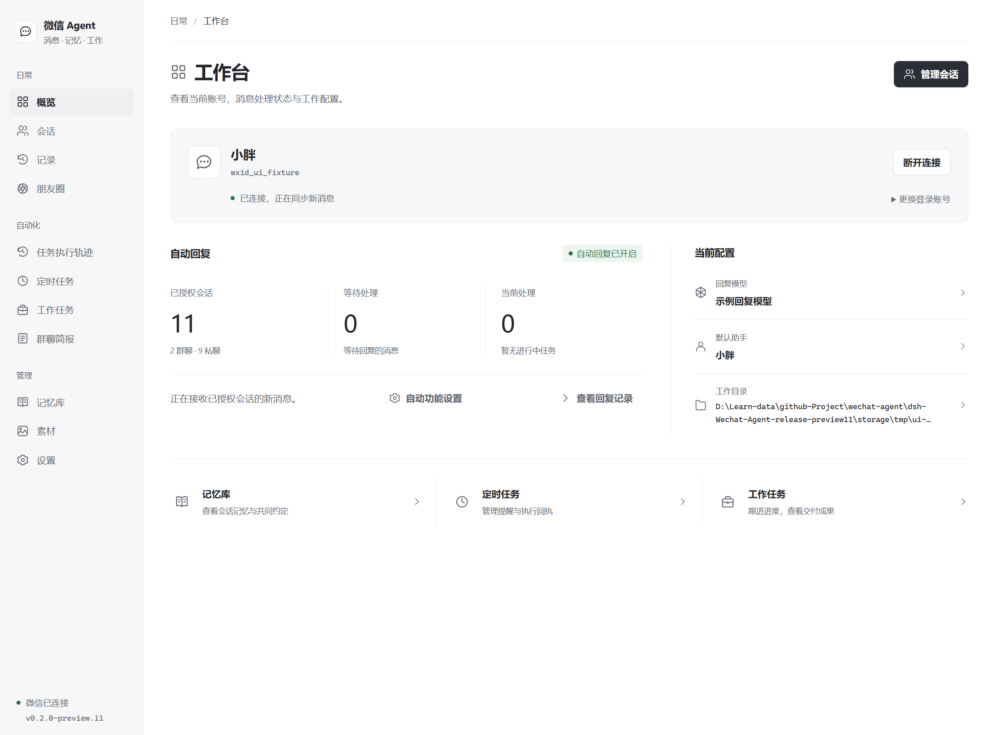
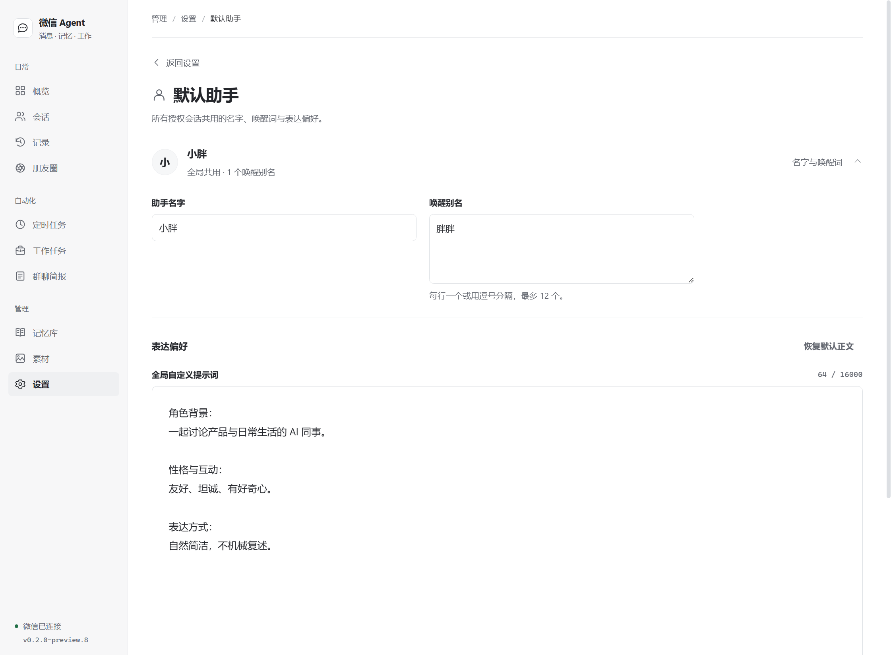
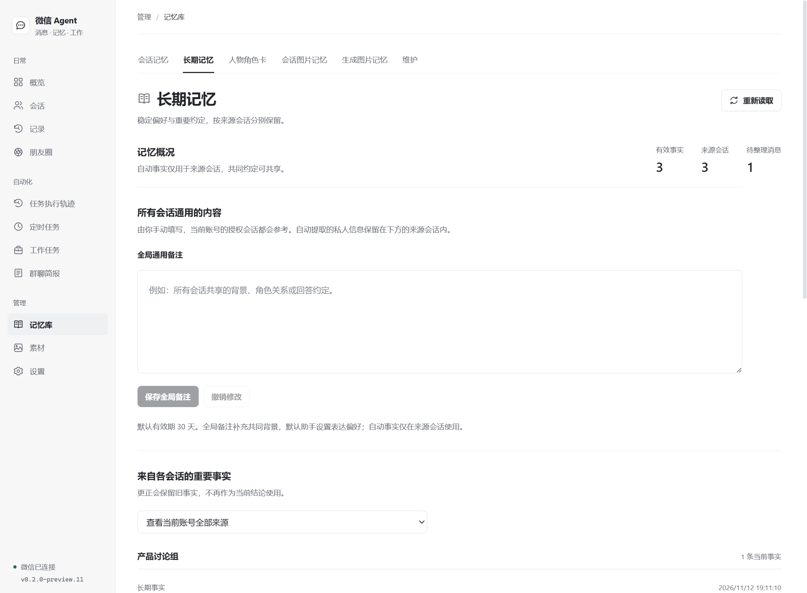
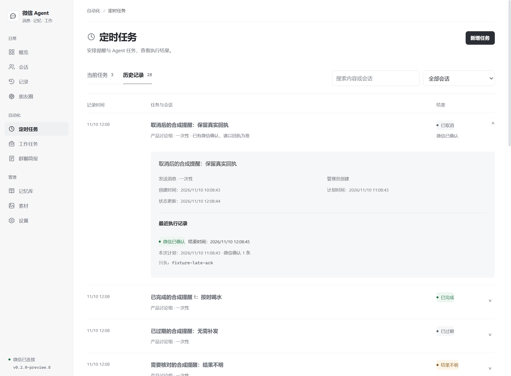
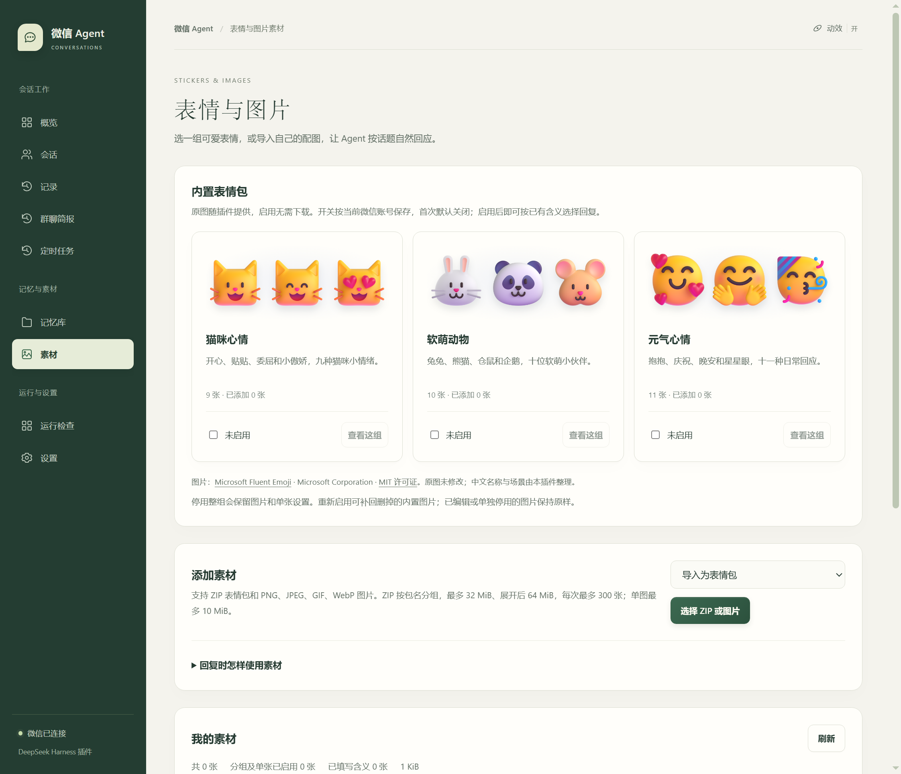

<div align="center">


**把 DSH 的模型、自然接话的助手和持久记忆，带进微信会话。**

[](https://www.npmjs.com/package/dsh-plugin-wechat-agent)
[](https://github.com/Bozheng-Li/dsh-Wechat-Agent/actions/workflows/ci.yml)
[](https://github.com/Bozheng-Li/dsh-Wechat-Agent/blob/main/LICENSE)

[开始使用](#开始使用) · [使用指南](https://github.com/Bozheng-Li/dsh-Wechat-Agent/blob/main/docs/USER-GUIDE.md) · [更新日志](https://github.com/Bozheng-Li/dsh-Wechat-Agent/blob/main/CHANGELOG.md) · [反馈问题](https://github.com/Bozheng-Li/dsh-Wechat-Agent/issues)

</div>

## 一个伙伴，多种相处方式

所有会话共用一位默认助手：日常自然接话，工作时把事情说清楚。保留一个全局自定义入口，各会话分别设置参与方式、保存记忆，也能在约定的时间提醒你。

| 能力 | 你可以这样用 |
| --- | --- |
| **默认助手（拟人，未发布）** | 只保留一位助手，在全局设置中自定义名字、唤醒词和表达偏好，所有会话共用。 |
| **共同的身份与语言** | 全局身份保存共同约定；所有对外回复遵守同一份语言边界，减少机械开场、空泛夸奖和客服式收尾。 |
| **两层持久记忆** | 近期对话接住上下文，旧资料按相关性或需要查询；长期 Markdown 保存有来源的事实与约定。 |
| **自然加入群聊** | 保留 @、`/agent`、昵称与数量设置，结合时间、话题和互动反馈择机参与，逐群控制。 |
| **看图与表情回复** | 普通图片先保存，按当前问题选择查看；表情包跳过图像理解，可用内置或自备素材回复。 |
| **把约定变成提醒** | 聊天中安排一次、每天或间隔任务，到期在授权会话发送消息，并真正 @ 群成员。 |
| **查资料，带上来源** | 默认选择 Tavily，也可切换 DeepSeek 原生搜索；分别配置密钥，保留可核对的来源。 |
| **工作模式（未发布初版）** | 开关打开后，模型根据当前消息和发起人的工作上下文判断是否工作；实际工作只读工作上下文，聊天才读聊天记录与人设。每位权限主有独立 DSH 会话，普通工作请求默认追加自己的当前会话，`/work new` 和并行子任务另开会话；工作、聊天固定各一个项目，关闭工作模式后只聊天。工作保留 DSH 默认模型、上下文与工具，独立任务默认并行 2 个；完成后润色文字并回传文件和图片，支持查询、取消、继续及查找已有成果。 |
| **生图 API（未发布）** | 支持多家兼容 `/images/generations` 的接口，每家配置多个模型与独立密钥；工作 Agent 按指定接口／模型生成并回传微信图片，支持 base64 和 URL 结果。 |
| **管理员远程查询（未发布）** | 搜索并添加多个全局或会话管理员，开启会话查询后直接说“看看电脑状态”“DSH 任务跑到哪了”；Agent 判断意图，后台读取真实状态，保留原 DSH 任务。 |
| **朋友圈（未发布）** | 独立菜单管理本人动态、评论、发布／删除和定时回复。聊天与工作模型共用 7 项朋友圈 tools；定时回复默认关闭，可配置周期、本人动态范围、历史评论和每轮尝试上限。文字发帖、删帖及指定回复已实测，图片上传已实测，图文整帖未实测；视频上传和媒体下载尚未接通。 |

## 开始使用

本页对应 **`0.2.0-preview.8`**，支持 **Windows x64 · DeepSeek Harness `0.2.1-rc.5`**。模型使用你在 DSH 中配置的服务。

本版整合人设输入修复、显式推理强度选择、相关记忆筛选和新的工作台。知识库功能已移除，已有资料文件保留；模型仍可能补写事实或未完整遵守人设，具体限制见[使用指南](docs/USER-GUIDE.md#当前版本与已知限制)，版本历史见更新日志。

在 DSH 插件管理页输入 `dsh-plugin-wechat-agent` 安装，或在 PowerShell 执行：

```powershell
dsh plugin --profile desktop add dsh-plugin-wechat-agent@0.2.0-preview.8
```

完整 npm 包包含微信认证组件、Python 与依赖，安装后即可打开侧栏 **微信 Agent**。

1. **扫码连接** — 用手机微信扫码并确认。
2. **设置助手与模型** — 选择 DSH 模型及其支持的推理强度，在“默认助手”中编辑所有会话共用的设定。
3. **授权会话** — 按微信名、备注或群名查找，选中会话，再开启自动回复。

首次安装的自动回复和内置表情分组默认关闭，由你选择启用范围。

未发布源码已按 `frontend/`、`backend/`、`modules/`、`prompts/` 分开；业务设置统一保存在工作目录的 `config.yaml`，人设和全局身份正文位于 `prompts/`。旧配置首次加载时备份并迁移，原授权和记录保留；本次统一为默认助手前会备份旧人设，之后的全局自定义内容不重复重置。外部修改 YAML 或它引用的人设文件后重新启用插件生效。源码维护入口见 [代码结构说明](docs/CODE-STRUCTURE.md)，当前 npm 版本仍以正式版本记录为准。

<details>
<summary>通过 DSH 自定义插件市场搜索安装</summary>

在“插件 → 实验性插件 → 更多 → 自定义插件市场”添加以下索引，搜索“微信”或 `wechat` 安装：

```text
https://raw.githubusercontent.com/Bozheng-Li/dsh-Wechat-Agent/main/market/index.json
```

DSH `0.2.1-rc.5` 使用用户添加的自定义索引。索引提供版本目录，完整插件从 npm 下载。

</details>

## 日常使用，在一个工作台里

连接、会话授权、处理记录、记忆、任务和素材各有清晰的入口。新版工作台以暖纸色与墨绿组织明暗主题，用对话便笺、留白和清晰的标题区分内容；首页可直接调整人设、查看记忆。动效可以暂停，也会跟随系统的“减少动态效果”设置。运行、等待、失败与微信已确认的结果分别显示，能看清当前发生了什么。



## 全局共用助手，记忆各有归属

默认助手只保留一个全局自定义编辑入口，恢复默认正文先修改草稿，保存后才生效。每个会话分别积累记忆；自动提取的事实保留原会话来源，跨会话共同约定可以由你写入全局备注。



记忆库集中管理会话上下文、全局备注、长期事实、图片记忆和维护。默认保存窗口为 100000 字符，可按群自定义；这不是每轮全部发送给模型的内容。普通接话优先使用近期对话，旧记忆按相关性筛选或按需查询，避免无关历史带偏话题。达到窗口后在后台整理，临时失败保留原文并自动重试。切换标签保留未保存草稿，保存时锁定当前会话；文件无法安全读取时显示原因并暂停编辑。



## 认真记下，也按时提醒

“微信助手，一分钟后提醒我吃饭。”保存成功后，约定进入当前任务列表。执行、取消与过期结果归入历史，每项一行，展开即可核对内容和真实回执。



## 给聊天一点表情

**猫咪心情 · 软萌动物 · 元气心情**，三组共 30 张 Microsoft Fluent Emoji 原图，随包提供来源和 MIT 许可证。可以整组启用、单张编辑，也能导入 ZIP 或自己的图片，调整使用概率与间隔。



以上应用截图来自本版界面的真实渲染，使用隔离的合成账号与会话；截图验证没有连接真实微信或调用付费模型。

## 消息与数据，都能核对

回复取得微信服务端回执后才记为成功。部分确认或结果不明时保留已知回执，暂停相应任务；发送恢复位于“处理记录”，核对后可处理或整理记录。升级和重启保留授权、设置、记忆与历史。

新版处理记录还显示本轮记忆模式、近期对话条数、预载旧记忆字数及关联线索。按需模式的“预载 0 字”只表示开始回复前没有灌入旧历史，不冒充已完成的记忆查询。

数据默认保存在 `~/.dsh/wechat-agent`，也可指定一个全局工作目录，统一管理身份、会话、记忆、素材与任务。模型请求发往你配置的 DSH 模型服务，开启搜索后公开查询发往选中的 Tavily 或 DeepSeek 搜索服务。

图片当前发送 PNG/JPEG 静态内容，GIF/WebP 转为第一帧并保留原文件。定时执行需要插件运行、微信在线与会话保持授权。插件读取同步到的新消息；语音、视频、一般文件解析和微信完整历史导入尚未包含。详细行为见使用指南。

## 文档与开发

| 文档 | 内容 |
| --- | --- |
| [使用指南](https://github.com/Bozheng-Li/dsh-Wechat-Agent/blob/main/docs/USER-GUIDE.md) | 回复模式、人设、身份、记忆、素材、提醒与目录迁移。 |
| [开发与发布](https://github.com/Bozheng-Li/dsh-Wechat-Agent/blob/main/docs/DEVELOPMENT.md) | 独立构建、测试、完整打包、包审计与 npm 发布。 |
| [代码结构](docs/CODE-STRUCTURE.md) | 模块职责、页面与业务入口、依赖边界及维护方式。 |
| [更新日志](https://github.com/Bozheng-Li/dsh-Wechat-Agent/blob/main/CHANGELOG.md) | 与应用内共用的版本记录。 |
| [界面与动效](docs/USER-GUIDE.md#界面与动效) | 当前源码的明暗配色、动效偏好与窄窗口布局。 |
| [第三方说明](https://github.com/Bozheng-Li/dsh-Wechat-Agent/blob/main/THIRD_PARTY_NOTICES.md) | 原项目、表情作品、运行环境与许可。 |

源码仓库可独立构建与测试。Node.js **22.18+**，执行 `npm ci`、`npm test`；完整安装包的准备方法见开发文档。

本项目源自 [Wechat Agent](https://github.com/2720480371/wechat-agent)，采用 **AGPL-3.0-or-later**。第三方素材与专有组件分别遵循原许可。项目与 DeepSeek、腾讯没有隶属关系。
