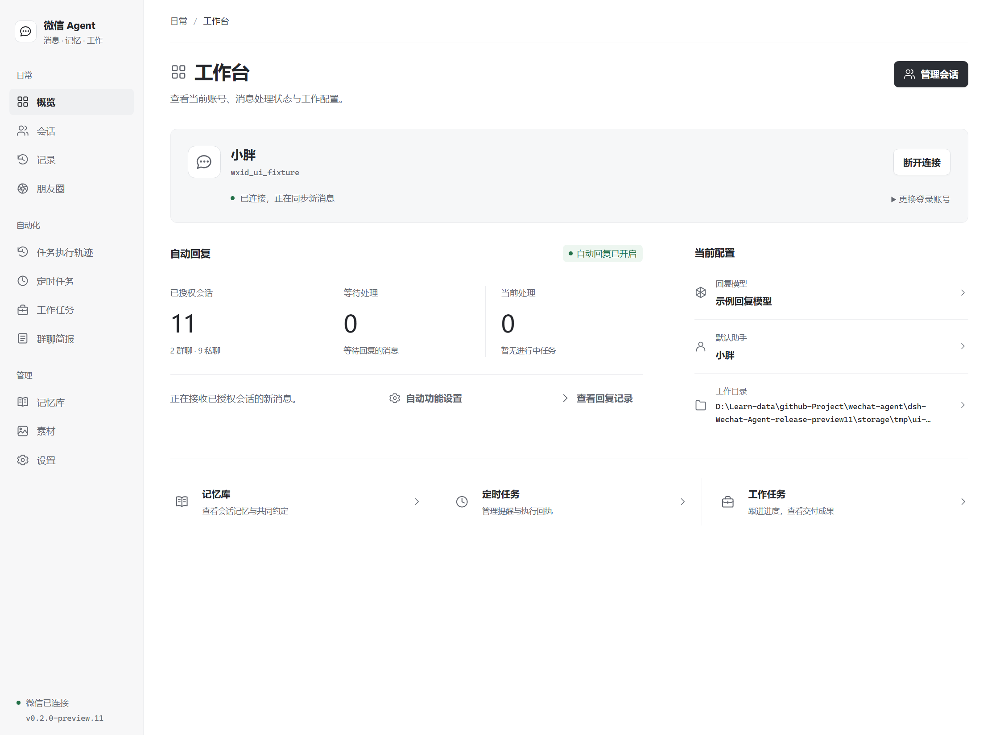
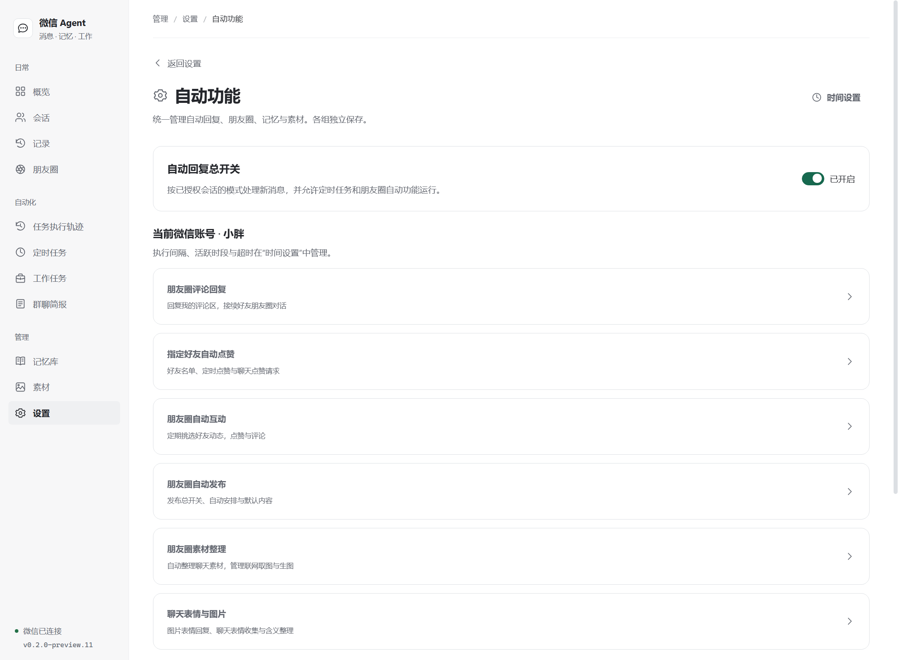
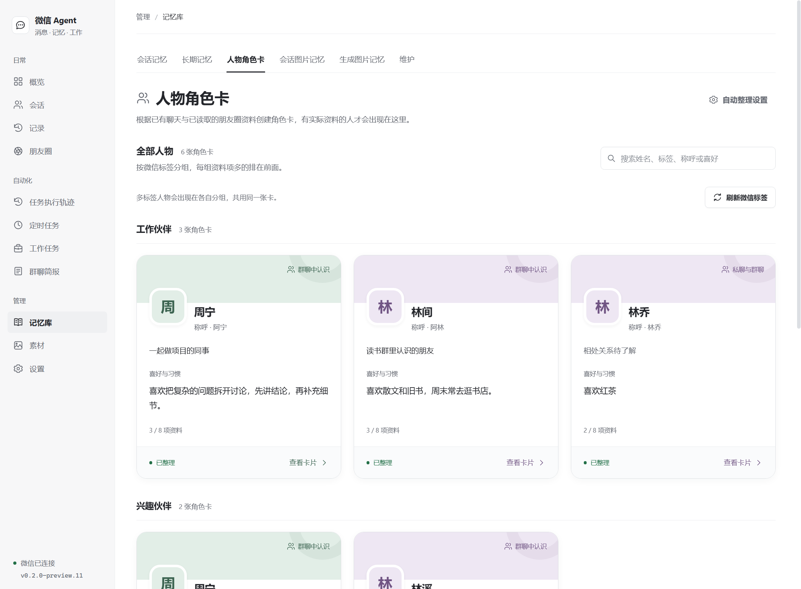
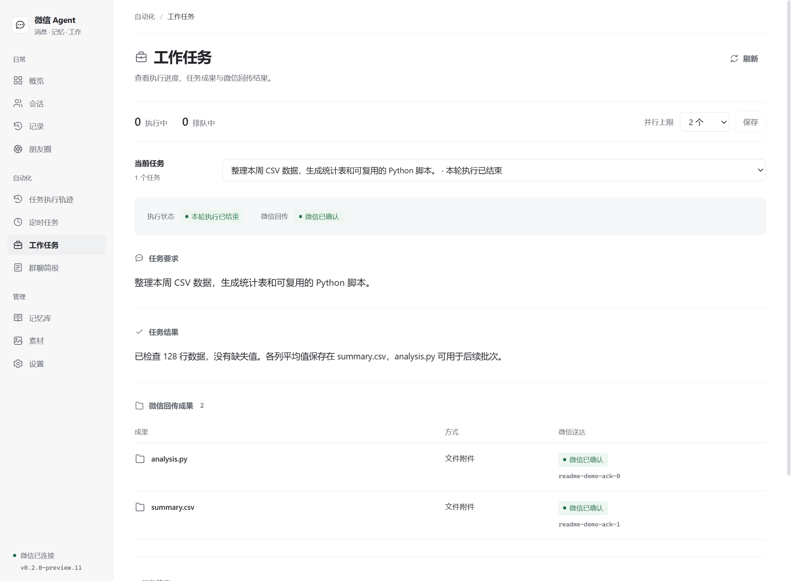
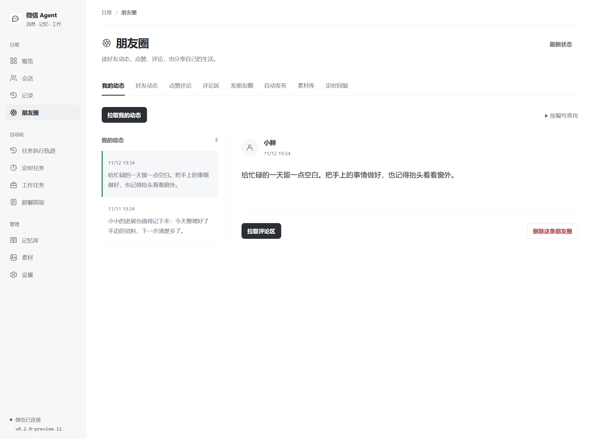

# 微信 Agent

把 DSH 助手接入微信：自然聊天、记住已授权的人、执行工作任务，并管理提醒与朋友圈。

[](https://www.npmjs.com/package/dsh-plugin-wechat-agent)
[](https://github.com/Bozheng-Li/dsh-Wechat-Agent/actions/workflows/ci.yml)
[](LICENSE)

候选版本 **0.2.0-preview.12（待远端发布）** · **Windows x64** · **DeepSeek Harness 0.2.1-rc.5**

本地完成了适用 App 业务能力同步和原生 DSH 验收；尚未上传 npm/GitHub，需先恢复发布凭据。当前可安装版本仍是 preview.11，已安装插件不会因仓库源码改变而自动升级。功能差异见 [App 同步说明](docs/APP-SYNC.md) 和 [候选变更日志](CHANGELOG.md)。

[开始使用](#开始使用) · [使用指南](docs/USER-GUIDE.md) · [更新日志](CHANGELOG.md) · [安装包](https://github.com/Bozheng-Li/dsh-Wechat-Agent/releases/tag/v0.2.0-preview.11) · [反馈问题](https://github.com/Bozheng-Li/dsh-Wechat-Agent/issues)



_preview.11 的实际界面，使用隔离的示例账号与内容。_

## 现在可以做什么

| 能力 | 当前用法 |
| --- | --- |
| 自然聊天 | 授权私聊可直接提问；群聊支持 @、昵称唤醒和统一的参与模式，可分别开启新消息、冷场和连续接话机会；模型可按本轮决定回复或跳过。 |
| 人设与记忆 | 支持当前全局人设及最多 12 条人设库，可从授权聊天提炼语言档案并试聊；人物卡、会话与长期记忆、收到和生成图片分别管理。 |
| 工作任务 | 已授权管理员通过微信委托 DSH 执行工作；支持新建、继续、并行、查询和取消，回传文字、图片与本机文件成果。 |
| 定时任务与群聊简报 | 安排一次、每日或间隔提醒，支持真实 @ 群成员；按配置整理群聊简报，查看下次执行时间和历史结果。 |
| 朋友圈 | 查看动态与评论，整理素材、生成草稿和安排发布；分别管理好友点赞、自动互动、评论回复与对话接续。 |
| 图片、表情与搜索 | 普通聊天可按需看图、从全库候选选表情或调用已配置生图接口；搜索可选 DSH 原生、DeepSeek Search API 或 Tavily。 |
| 执行与回执 | 任务轨迹记录模型与工具过程；处理记录展示显式 `<SPLIT>` 分段及逐条回执，可核对只发送明确未发出的部分。 |

preview.11 的重点是**对象授权与清理、人物卡标签分组、自动功能集中设置、统一时间设置和任务轨迹**。上方功能表描述 preview.12 本地候选源码，尚未进入 npm/GitHub 分发；完整变化与验证范围见 [CHANGELOG](CHANGELOG.md)。

## 开始使用

先安装并配置 **DeepSeek Harness 0.2.1-rc.5**。插件使用 DSH 中配置的模型服务；完整安装包包含微信认证组件、Python 与固定版本依赖。

在 DSH 插件管理页添加 `dsh-plugin-wechat-agent`。当前公开包为 preview.11；如果已安装 DSH 命令行，也可指定这个已发布版本：

```powershell
dsh plugin --profile desktop add dsh-plugin-wechat-agent@0.2.0-preview.11
```

[npm](https://www.npmjs.com/package/dsh-plugin-wechat-agent/v/0.2.0-preview.11) 与 [GitHub Releases](https://github.com/Bozheng-Li/dsh-Wechat-Agent/releases/tag/v0.2.0-preview.11) 提供同一份完整安装包，Release 附有 SHA-256 校验文件。

1. **扫码连接**：打开 DSH 侧栏“微信 Agent”，用手机微信扫码并确认。
2. **设置模型与人设**：在“设置 → 模型设置”选择回复模型；在“默认助手”编辑当前人设，或切到“人设库”新建、提炼授权聊天语言和试聊。所有会话共用当前选中的人设。
3. **选择授权范围**：打开侧栏“会话”，按微信名、备注或群名查找，选择需要的会话并授权。
4. **分别管理自动功能**：在“设置 → 自动功能”控制自动回复、定时任务和朋友圈自动功能。新安装默认关闭自动回复和朋友圈自动化；旧配置中未单独设置的提醒开关继续跟随旧总开关。
5. **配置群参与与可选能力**：在会话详情分别选择新消息、冷场和连续接话机会。高精度人设会多进行一轮模型调用；普通聊天生图需配置图片生成 API。

以上功能步骤描述 preview.12 候选源码。远端发布尚未完成，已安装及目前可下载的 **0.2.0-preview.11** 仍按发布版运行。

<details>
<summary>通过自定义插件市场安装或升级</summary>

在 DSH 的“插件 → 实验性插件 → 更多 → 自定义插件市场”添加以下索引，再搜索“微信”或 `wechat`：

```text
https://raw.githubusercontent.com/Bozheng-Li/dsh-Wechat-Agent/main/market/index.json
```

市场索引提供版本目录，插件本体从 npm 下载。发布后重新加载市场的版本列表，再选择新版本安装或升级。

</details>

**升级与版本核对。** 仓库推送后，已安装插件仍使用原版本。刷新插件市场的版本列表并完成升级，再到“设置 → 更新日志”核对实际版本。本仓库当前源码尚未发布，npm `latest`、市场索引与 GitHub Release 仍指向已发布的 preview.11。

**升级前核对授权。** preview.11 启动时会按发布版规则清理历史未授权对象；已授权群聊成员继承人物资料与朋友圈操作授权，私聊回复仍按会话设置和授权执行。取消授权会停止相关操作并清理本机资料；自动开关仅暂停对应功能，保留仍有效的授权和资料。

## 当前工作台

侧栏按“日常、自动化、管理”分组，支持明暗主题和窄窗口导航。

| 分组 | 页面 | 用途 |
| --- | --- | --- |
| 日常 | 概览、会话、记录、朋友圈 | 连接账号、授权会话、核对回复和管理动态。 |
| 自动化 | 任务执行轨迹、定时任务、工作任务、群聊简报 | 查看执行过程，管理提醒、委托与简报。 |
| 管理 | 记忆库、素材、设置 | 查看人物与来源，管理表情图片、模型、管理员和工作目录。 |

“设置 → 自动功能”分别管理自动回复、定时任务和朋友圈自动功能；暂停某项不会关闭另两项。“设置 → 时间设置”管理执行间隔、活跃时段、超时和保存期限。账号、会话与全局的设置范围在页面中标明。



## 一个全局助手与人设库，共享资料按来源归属

所有会话共用当前选中的全局助手人设；管理员可以在“默认助手 → 人设库”保存多条人设、切换、从授权聊天提炼语言档案和先行试聊。高精度模式可选，先整理事实与工具结果再由独立无工具会话按人设表达，代价是增加一次模型调用。工作任务、视觉理解等内部专用任务不套用这两阶段。

人物角色卡记录聊天对象的称呼、关系、喜好和背景，可查看来源、按请求时点读取及手动纠正。人物卡按微信真实身份归档；同名人物不会合并。记忆库还管理会话上下文、全局备注、长期事实、收到图片和生成图片；收到与生成的图片可分别设置自动保存及保留期限。历史作者、方向和本地时间随上下文提供；生成图追问可读取原图，但只在图片实际送达且回执核对后向群内其他成员开放。



记忆库还管理会话上下文、全局备注、长期事实、收到的图片和生成的图片。收到与生成的图片可分别设置自动保存及保留期限。“按需加载”是模型高级设置中的可选模式：先接近期对话，需要时再查询旧资料和工具说明；默认仍为完整上下文兼容模式。[查看记忆说明](docs/USER-GUIDE.md#人物角色卡与分层记忆)

## 在微信委托工作，回看过程和成果

在本机添加全局或会话管理员，为对应会话开启远程查询，再将“会话设置 → 执行方式”设为“工作模式”。工作由 DSH 原生会话执行，使用 DSH 的默认模型、工具和工作目录。

```text
/work 写一个 Python 脚本，计算 CSV 每列的平均值，并运行一个示例
/work new 处理另一项独立任务
/work status
/work continue 任务编号 增加缺失值处理
/work cancel 任务编号
```

也可以用自然语言说明委托。普通工作与 `/work <要求>` 接续当前发起人的 DSH 会话，`/work new` 主动新开；不同发起人的工作上下文分别保存。开始时简短确认，长任务按实际进展报告，结束后集中回传成果。

“工作任务”分别展示执行状态、文件和送达情况；“任务执行轨迹”可查看关联的模型请求、工具调用与结果。管理员还可查询电脑与当前 DSH 任务状态。[查看工作与权限说明](docs/USER-GUIDE.md#工作模式)



## 朋友圈，从素材到发布和互动

朋友圈页面集中查看动态、评论、素材与发布安排。可以先生成草稿审阅，也可按计划自动发布；素材库保存随手记、图片和聊天启发，并记录来源、有效期与使用情况。



在“自动功能”分别控制指定好友点赞、自动互动、自己评论区回复、好友朋友圈对话接续，以及自动发布和素材整理。多图分批识别；部分图片失败时使用可核对的图文，无可用依据时跳过评论。

朋友圈操作遵循当前对象授权。发布会屏蔽未授权联系人，也可额外选择屏蔽对象；无法核实可见范围时保留草稿。微信回执不明时保留状态，不自动重发。[查看朋友圈说明](docs/USER-GUIDE.md#朋友圈)

## 表情、图片与提醒

- **表情**：在“素材 → 聊天图片与表情”同步微信收藏、收集授权聊天表情或导入 ZIP。开启时，模型按当前语境从完整启用素材库获得少量预读候选；候选不会自动发送，每轮至多一张并受间隔约束。微信原生表情优先保留动画。
- **图片**：支持按需理解收到图片、查询已保存图片；配置生图 API 后普通聊天可按需生成并发送 PNG/JPEG。生成原件与提示词可归档到生成图片记忆，确认回执后更新送达状态。
- **提醒**：支持一次、每日和间隔任务，可在授权群真实 @ 成员；提醒可独立于自动回复暂停或运行。定时执行需要插件运行、微信在线及会话保持授权。
- **搜索**：可选择 DSH DeepSeek 原生搜索、DeepSeek Search API 或 Tavily，配置备用接口并结合来源回答有时效性的问题。

## 数据与当前限制

数据默认位于 `$DSH_HOME/wechat-agent`（通常为 `~/.dsh/wechat-agent`），可在“设置 → 工作目录”更改。业务配置保存在 `config.yaml`，自定义助手与身份正文位于 `prompts/`。模型请求发往你配置的服务；启用搜索或图片生成后，相关请求发往所选接口。

发送取得微信服务端回执后才标为确认成功，部分确认或结果不明会单独记录。可以在“记录 → 发送恢复”核对和处理；工作完成与成果送达分别记录。

当前不提供微信完整历史导入、语音／视频解析；微信附件下载、正文解析与引用附件读取已停用，本机工作成果发送继续可用。图像理解受模型和原图质量影响；模型回答与人物整理仍可能出错，重要事实应核对来源。详见[当前版本与已知限制](docs/USER-GUIDE.md#当前版本与已知限制)。

本页截图使用 **preview.11 的实际前端构建**，账号、会话和内容为隔离的合成数据。截图过程不连接真实微信、不调用付费模型。

更多界面：[深色工作台](docs/images/workspace-dark.png) · [时间设置](docs/images/studio-time-light.png) · [默认助手](docs/images/studio-persona-editor-light.png) · [长期记忆](docs/images/studio-memory-light.png) · [定时任务历史](docs/images/studio-tasks-light.png) · [表情与图片素材](docs/images/studio-stickers-light.png)。

## 文档与开发

| 文档 | 内容 |
| --- | --- |
| [使用指南](docs/USER-GUIDE.md) | 回复模式、管理员、工作、朋友圈、记忆、自动功能和数据目录。 |
| [开发与发布](docs/DEVELOPMENT.md) | 构建、测试、完整打包、审计与 npm 发布。 |
| [代码结构](docs/CODE-STRUCTURE.md) | 模块职责、页面入口与依赖边界。 |
| [更新日志](CHANGELOG.md) | 与应用内共用的版本记录、修复和验证范围。 |
| [第三方说明](THIRD_PARTY_NOTICES.md) | 原项目、运行组件与许可证。 |

源码开发需要 Node.js **22.18+**。执行 `npm ci` 安装依赖，`npm test` 构建并运行回归；完整 Windows 安装包的准备与审计见开发文档。

本项目源自 [Wechat Agent](https://github.com/2720480371/wechat-agent)，采用 **AGPL-3.0-or-later**。第三方素材与专有组件分别遵循原许可。项目与 DeepSeek、腾讯没有隶属关系。
