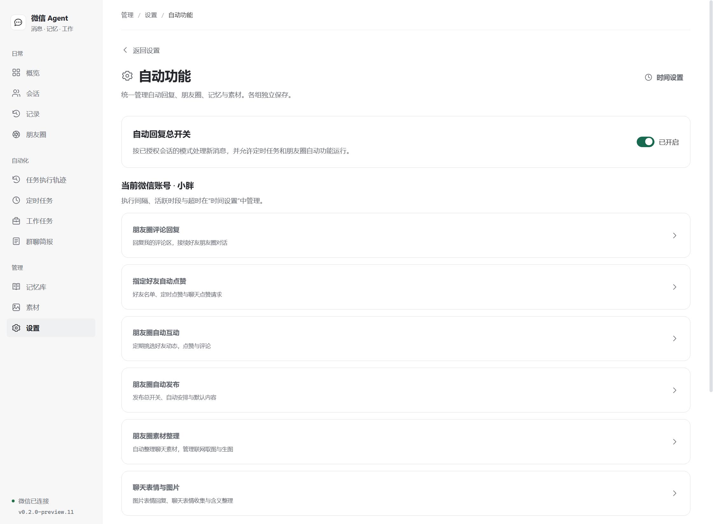
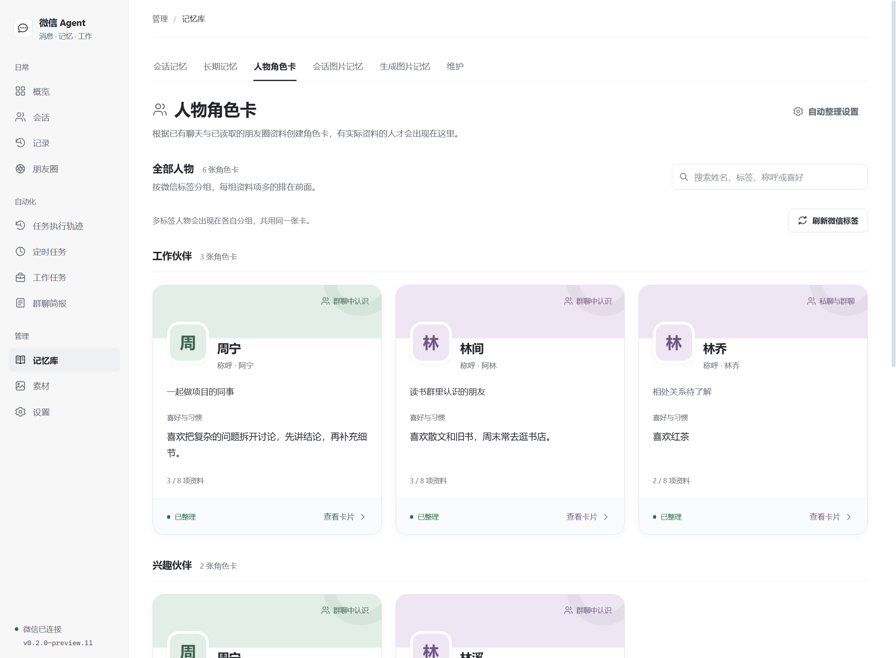
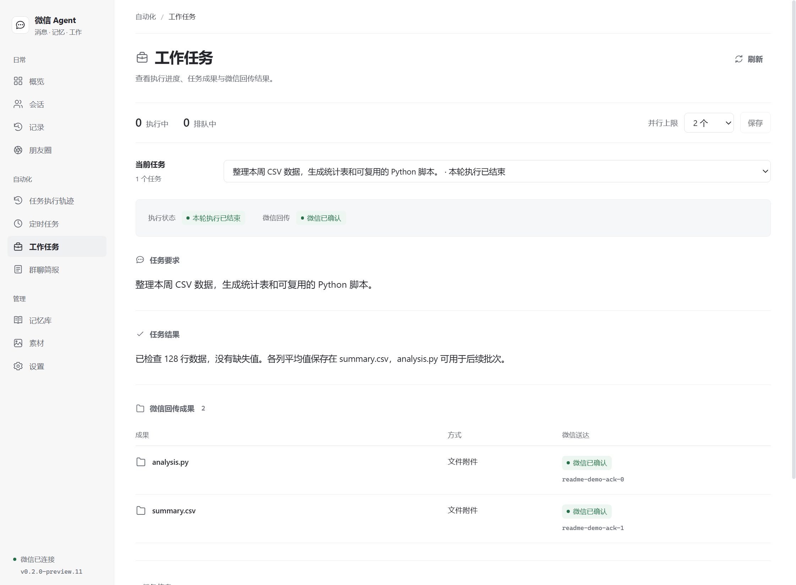
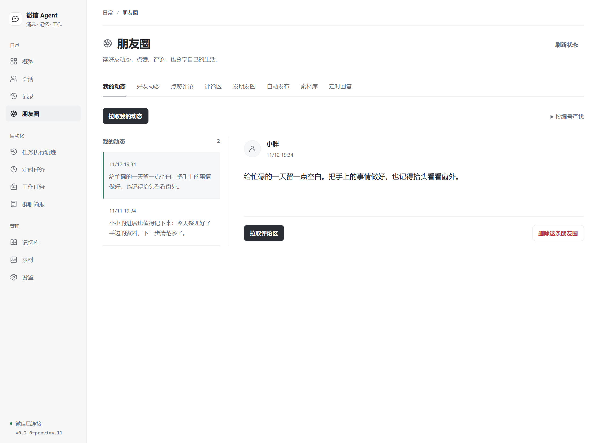

# 微信 Agent

把 DSH 助手接入微信：自然聊天、记住已授权的人、执行工作任务，并管理提醒与朋友圈。

[](https://www.npmjs.com/package/dsh-plugin-wechat-agent)
[](https://github.com/Bozheng-Li/dsh-Wechat-Agent/actions/workflows/ci.yml)
[](LICENSE)

当前版本 **0.2.0-preview.11** · **Windows x64** · **DeepSeek Harness 0.2.1-rc.5**

[开始使用](#开始使用) · [使用指南](docs/USER-GUIDE.md) · [更新日志](CHANGELOG.md) · [安装包](https://github.com/Bozheng-Li/dsh-Wechat-Agent/releases/tag/v0.2.0-preview.11) · [反馈问题](https://github.com/Bozheng-Li/dsh-Wechat-Agent/issues)


_preview.11 的实际界面，使用隔离的示例账号与内容。_

## 现在可以做什么

| 能力 | 当前用法 |
| --- | --- |
| 自然聊天 | 日常聊天共用默认助手和全局身份；已授权私聊直接提问，群聊可选 @、昵称唤醒、按消息条数参与或自然陪聊。 |
| 人物与记忆 | 根据已授权的聊天和朋友圈原文整理人物卡，按微信标签分组；保留来源和纠正，会话记忆、收到的图片与生成的图片分别管理。 |
| 工作任务 | 已授权管理员通过微信委托 DSH 执行工作；支持新建、继续、并行、查询和取消，回传文字、图片与本机文件成果。 |
| 定时任务与群聊简报 | 安排一次、每日或间隔提醒，支持真实 @ 群成员；按配置整理群聊简报，查看下次执行时间和历史结果。 |
| 朋友圈 | 查看动态与评论，整理素材、生成草稿和安排发布；分别管理好友点赞、自动互动、评论回复与对话接续。 |
| 图片、表情与搜索 | 按需看图，同步微信收藏和聊天表情；配置图片生成接口，以及 Tavily 或 DeepSeek 原生搜索。 |
| 执行与回执 | 工作台看运行状态，任务轨迹看模型和工具过程，处理记录核对微信回执；区分执行完成、已送达和结果不明。 |

preview.11 的重点是**对象授权与清理、人物卡标签分组、自动功能集中设置、统一时间设置和任务轨迹**。完整变化与验证范围见 [CHANGELOG](CHANGELOG.md)。

## 开始使用

先安装并配置 **DeepSeek Harness 0.2.1-rc.5**。插件使用 DSH 中配置的模型服务；完整安装包包含微信认证组件、Python 与固定版本依赖。

在 DSH 插件管理页添加 `dsh-plugin-wechat-agent`。如果已安装 DSH 命令行，也可以在 PowerShell 指定本版：

```powershell
dsh plugin --profile desktop add dsh-plugin-wechat-agent@0.2.0-preview.11
```

[npm](https://www.npmjs.com/package/dsh-plugin-wechat-agent/v/0.2.0-preview.11) 与 [GitHub Releases](https://github.com/Bozheng-Li/dsh-Wechat-Agent/releases/tag/v0.2.0-preview.11) 提供同一份完整安装包，Release 附有 SHA-256 校验文件。

1. **扫码连接**：打开 DSH 侧栏“微信 Agent”，用手机微信扫码并确认。
2. **设置助手**：在“设置 → 模型设置”选择回复模型；在“默认助手”和“全局身份”填写名字、表达偏好与共同约定。
3. **选择授权范围**：打开侧栏“会话”，按微信名、备注或群名查找，选择需要的会话并授权。
4. **开启自动回复**：进入“设置 → 自动功能”打开总开关，再在单个会话中设置回复模式。首次安装默认关闭自动回复。
5. **按需开启其他能力**：朋友圈、人物整理和图片记忆各有独立设置；工作模式还需要管理员身份和会话远程查询权限。

<details>
<summary>通过自定义插件市场安装或升级</summary>

在 DSH 的“插件 → 实验性插件 → 更多 → 自定义插件市场”添加以下索引，再搜索“微信”或 `wechat`：

```text
https://raw.githubusercontent.com/Bozheng-Li/dsh-Wechat-Agent/main/market/index.json
```

市场索引提供版本目录，插件本体从 npm 下载。发布后重新加载市场的版本列表，再选择新版本安装或升级。

</details>

**升级与版本核对。** 仓库推送后，已安装插件仍使用原版本。刷新插件市场的版本列表并完成升级，再到“设置 → 更新日志”核对实际版本。本版 npm 的 `latest`、`next` 和市场索引均已更新；也可使用上面的命令直接安装 `@0.2.0-preview.11`。

**升级前核对授权。** 本版启动时会补清理历史未授权对象的本机资料；群聊授权不包含群成员的私聊、个人资料或朋友圈操作权限。需要保留的人物，请先核对其私聊授权。取消授权会停止相关操作并清理本机记忆、任务、素材及关联记录；重新授权从新资料开始。仅关闭自动回复总开关会暂停执行，保留有效授权与资料。

## 当前工作台

侧栏按“日常、自动化、管理”分组，支持明暗主题和窄窗口导航。

| 分组 | 页面 | 用途 |
| --- | --- | --- |
| 日常 | 概览、会话、记录、朋友圈 | 连接账号、授权会话、核对回复和管理动态。 |
| 自动化 | 任务执行轨迹、定时任务、工作任务、群聊简报 | 查看执行过程，管理提醒、委托与简报。 |
| 管理 | 记忆库、素材、设置 | 查看人物与来源，管理表情图片、模型、管理员和工作目录。 |

“设置 → 自动功能”集中管理开关与规则；“设置 → 时间设置”集中管理执行间隔、活跃时段、超时和保存期限。各组独立保存，账号和会话的设置范围在页面中标明。提醒日期与发布计划的具体时间仍在对应任务中编辑。



## 共用一个助手，记忆有来源和归属

“默认助手”提供一个全局自定义入口，所有会话共用；“全局身份”保存共同约定。人物角色卡记录的是聊天对象的称呼、关系、喜好和背景，可查看原文依据、手动纠正或触发整理。

人物卡按当前账号内的真实微信身份归档；同一位已单独授权的人在私聊、已授权群聊和朋友圈共用资料。**有实际资料才建卡**，仅姓名或发言记录不会产生空卡。同名人物不会合并；卡片按真实微信标签分组，默认资料项较多的在前。



记忆库还管理会话上下文、全局备注、长期事实、收到的图片和生成的图片。收到与生成的图片可分别设置自动保存及保留期限。“按需加载”是模型高级设置中的可选模式：先接近期对话，需要时再查询旧资料和工具说明；默认仍为完整上下文兼容模式。[查看记忆说明](docs/USER-GUIDE.md#人物角色卡与分层记忆)

## 在微信委托工作，回看过程和成果

在本机添加全局或会话管理员，为对应会话开启远程查询，再将“会话设置 → 执行方式”设为“工作模式”。工作由 DSH 原生会话执行，使用 DSH 的默认模型、工具和工作目录。

```text
/work 写一个 Python 脚本，计算 CSV 每列的平均值，并运行一个示例
/work new 处理另一项独立任务
/work status
/work continue 任务编号 增加缺失值处理
/work cancel 任务编号
```

也可以用自然语言说明委托。普通工作与 `/work <要求>` 接续当前发起人的 DSH 会话，`/work new` 主动新开；不同发起人的工作上下文分别保存。开始时简短确认，长任务按实际进展报告，结束后集中回传成果。

“工作任务”分别展示执行状态、文件和送达情况；“任务执行轨迹”可查看关联的模型请求、工具调用与结果。管理员还可查询电脑与当前 DSH 任务状态。[查看工作与权限说明](docs/USER-GUIDE.md#工作模式)



## 朋友圈，从素材到发布和互动

朋友圈页面集中查看动态、评论、素材与发布安排。可以先生成草稿审阅，也可按计划自动发布；素材库保存随手记、图片和聊天启发，并记录来源、有效期与使用情况。



在“自动功能”分别控制指定好友点赞、自动互动、自己评论区回复、好友朋友圈对话接续，以及自动发布和素材整理。多图分批识别；部分图片失败时使用可核对的图文，无可用依据时跳过评论。

朋友圈操作遵循当前对象授权。发布会屏蔽未授权联系人，也可额外选择屏蔽对象；无法核实可见范围时保留草稿。微信回执不明时保留状态，不自动重发。[查看朋友圈说明](docs/USER-GUIDE.md#朋友圈)

## 表情、图片与提醒

- **表情**：在“素材 → 聊天图片与表情”同步自己的微信收藏，也可收集授权聊天表情或导入 ZIP。保存含义和使用情景，模型按语境选择；微信原生表情优先保留动画，普通图片回退为静态帧。
- **图片**：支持按需理解图片、查询图片记忆和配置多个图片生成接口。生成图保留原件、实际提示词和送达回执。
- **提醒**：支持一次、每日和间隔任务，可在授权群真实 @ 成员；历史中保留执行结果。定时执行需要插件运行、微信在线、自动回复开启和会话保持授权。
- **搜索**：可选择 Tavily 或 DeepSeek 原生搜索，配置备用接口，结合来源回答有时效性的问题。

## 数据与当前限制

数据默认位于 `$DSH_HOME/wechat-agent`（通常为 `~/.dsh/wechat-agent`），可在“设置 → 工作目录”更改。业务配置保存在 `config.yaml`，自定义助手与身份正文位于 `prompts/`。模型请求发往你配置的服务；启用搜索或图片生成后，相关请求发往所选接口。

发送取得微信服务端回执后才标为确认成功，部分确认或结果不明会单独记录。可以在“记录 → 发送恢复”核对和处理；工作完成与成果送达分别记录。

当前不提供微信完整历史导入、语音／视频解析；微信附件下载、正文解析与引用附件读取已停用，本机工作成果发送继续可用。图像理解受模型和原图质量影响；模型回答与人物整理仍可能出错，重要事实应核对来源。详见[当前版本与已知限制](docs/USER-GUIDE.md#当前版本与已知限制)。

本页截图使用 **preview.11 的实际前端构建**，账号、会话和内容为隔离的合成数据。截图过程不连接真实微信、不调用付费模型。

更多界面：[深色工作台](docs/images/workspace-dark.png) · [时间设置](docs/images/studio-time-light.png) · [默认助手](docs/images/studio-persona-editor-light.png) · [长期记忆](docs/images/studio-memory-light.png) · [定时任务历史](docs/images/studio-tasks-light.png) · [表情与图片素材](docs/images/studio-stickers-light.png)。

## 文档与开发

| 文档 | 内容 |
| --- | --- |
| [使用指南](docs/USER-GUIDE.md) | 回复模式、管理员、工作、朋友圈、记忆、自动功能和数据目录。 |
| [开发与发布](docs/DEVELOPMENT.md) | 构建、测试、完整打包、审计与 npm 发布。 |
| [代码结构](docs/CODE-STRUCTURE.md) | 模块职责、页面入口与依赖边界。 |
| [更新日志](CHANGELOG.md) | 与应用内共用的版本记录、修复和验证范围。 |
| [第三方说明](THIRD_PARTY_NOTICES.md) | 原项目、运行组件与许可证。 |

源码开发需要 Node.js **22.18+**。执行 `npm ci` 安装依赖，`npm test` 构建并运行回归；完整 Windows 安装包的准备与审计见开发文档。

本项目源自 [Wechat Agent](https://github.com/2720480371/wechat-agent)，采用 **AGPL-3.0-or-later**。第三方素材与专有组件分别遵循原许可。项目与 DeepSeek、腾讯没有隶属关系。
