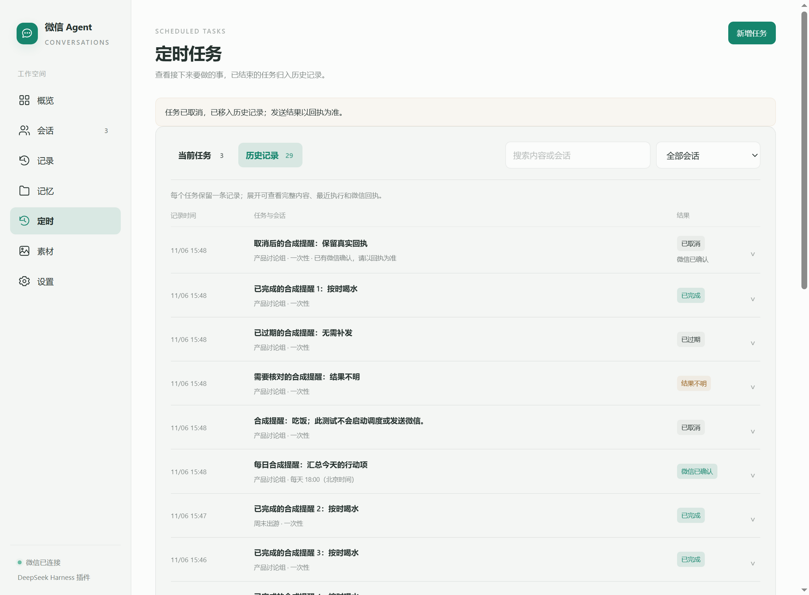

# 定时任务布局调整 · 未发布

2026-11-06。此文记录首次布局验收；本机随后已安装包含此布局的整合构建，详见[本机更新记录](LOCAL-UPDATE-2026-11-06.md)。尚未公开发布新的 npm 版本，后续整合回归已达 240 / 240 通过。

## 展示变化

- “当前任务”使用紧凑列表，仅显示等待、运行和暂停任务；结果不明或失败原因仍直接可见。
- “历史记录”每个任务显示一行。已完成、取消和过期任务不再重复占用任务卡片；循环任务的多次执行汇总到该行的详情中。
- 展开后可以查看完整内容、计划与实际结束时间、最近执行结果及微信回执；数据保留，不删除调度文件中的任务或执行记录。
- 新增表单默认收起，收起保留草稿。两种列表均支持会话筛选、内容搜索和每页 20 项的分页。
- 历史中的完成时间使用实际执行结束时间，避免把计划时间当成完成时间。取消后仍在收尾的任务显示“等待最终结果”，迟到的真实回执继续保留。



截图使用隔离合成任务，不是用户的真实聊天记录。

## 验证

| 检查 | 结果 |
| --- | --- |
| 本地构建 | 通过 |
| 历史数据专用检查 | 4 / 4 通过：不重复展示、真实完成时间、循环执行归并、取消收尾与迟到回执、无执行记录的过期任务及会话范围 |
| 定时页实际界面检查 | 3 组通过，11 张截图，无浏览器错误 |
| 桌面与窄窗口 | 1280 × 940 与 430 × 900，明暗主题均无横向溢出 |
| 操作 | 新建、暂停、恢复、取消、草稿保留、会话筛选、搜索、分页、展开后轮询保留、键盘切换和账号隔离通过 |

界面样本包括 24 个已完成任务、已取消与过期任务、等待任务、结果不明的暂停任务，以及带三次执行记录的循环任务。已完成任务在当前列表中不存在，在历史中只对应一行；回执和失败原因可以继续查看。验证没有向真实微信发送消息。

本轮全量回归曾运行 204 项，199 项通过、5 项失败。失败位于一分钟提醒、会话工具限制、自然回复规则、工作区迁移和旧状态写入保护测试；同一工作区在验证期间也有这些模块的其他修改。全量检查没有标记为通过；另行执行的定时页专用检查已通过。整套界面流程也在旧的设置入口文本处停止，因此本次使用独立的定时页验证入口完成页面验收。

本机详细报告：`storage/logs/tasks-layout-preview/report.json`；全量回归记录：`storage/logs/task-layout-tests.txt`。

2026-11-06 后续整合复验：原有五项失败涉及的模块已通过完整回归，当前 240 项全部通过；完整界面流程通过 33 组交互，包含定时页的当前任务、历史、搜索、分页和真正 @ 的选择操作。带 @ 的一分钟隔离计时在 60.569 秒触发且只执行一次。先前失败记录保留，详情见[整合验收](IDENTITY-MEMORY-WORKSPACE-2026-11-06.md)。

复现专用验证：

```powershell
npm run build
node --test tests/task-history.test.mjs
$env:WECHAT_UI_TEST_TASKS_ONLY = '1'
node scripts/test-ui.mjs <electron.exe 的绝对路径>
```
