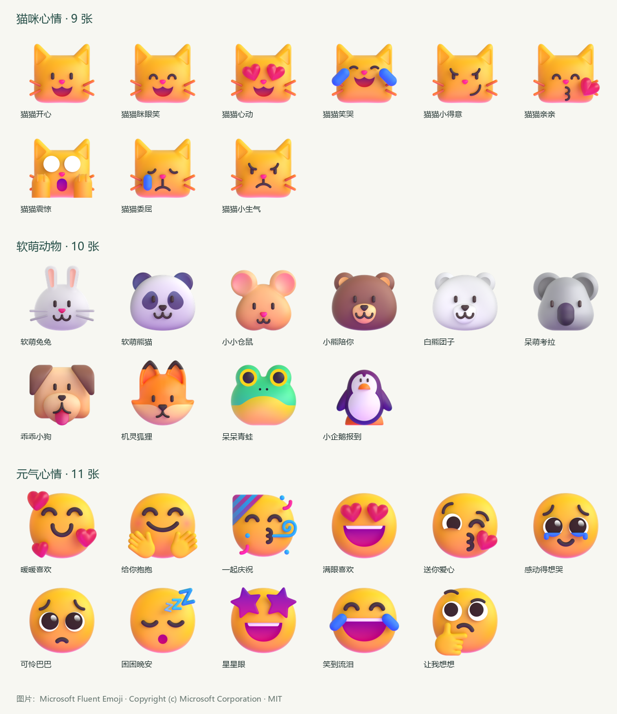

# 微信 Agent 使用指南

[产品首页](https://github.com/Bozheng-Li/dsh-Wechat-Agent#readme) · [开发与发布](DEVELOPMENT.md) · [更新日志](../CHANGELOG.md)

适用于 Windows x64、DeepSeek Harness 0.2.1-rc.5 与插件 0.2.0-preview.9。本版包含统一默认助手、会话角色卡、分层记忆、按需上下文、图片引用、工作模式和朋友圈自动化。安装方法见产品首页，版本历史见更新日志。

## 当前版本与已知限制

本页说明 `0.2.0-preview.9` 的功能与使用方式。GitHub 与 npm 的对应安装包、校验结果和版本变化见[更新日志](../CHANGELOG.md)，首页也提供可折叠的更新摘要。源码或本地后续修改记在“未发布”；更新仓库或发布安装包不会自动升级正在运行的插件。

本版修复编辑器保存的人设分块和恢复会话的上下文筛选。实际模型仍可能补出未提供的经历、去向、时长或心理状态，漏完整名字，或者出现机械或不合适的表达。代码回归、请求结构与工具链检查通过，不代表真实回答已全面满足人设和事实要求；需要核对重要事实、数字和日期。

图像理解取决于所选模型及微信实际提供的图片质量；只有缩略图时，小字和细节可能无法核实。语音、视频、一般文件解析、微信完整历史导入和动态图片发送尚未包含。定时任务需要插件运行、微信在线和会话保持授权。知识库导入与检索已移除，已有本地资料不自动删除。

## 首次使用

管理员在账号要求或全局身份中写明“第一行必须单独写‘固定文字’”或“最后一行必须单独写‘固定文字’”时，后台会补齐该行并保留正文；相同位置冲突时，全局身份的明确约定优先。仅补齐明确、无条件的单行文字，条件要求、引用示例、内部整理及空图片配文不会自动补字。

安装后：

1. 打开 DSH 侧栏“微信 Agent”，扫码并在手机确认。
2. 在“设置 → 模型设置”选择 DSH 模型或跟随默认。选中具体回复模型后，插件会向 DSH 查询其推理强度档位；选择后自动保存，从下一个任务开始生效。高级设置可开启图像理解和联网搜索。
3. 在“设置 → 默认助手”编辑全局自定义正文，所有会话共用。需要修改名字和唤醒词时展开对应设置。
4. 在“会话授权”输入微信名、备注或群名，从匹配列表中选择并添加，再启用自动回复。例如输入“李”，会列出所有已发现的相关会话供选择。
5. 在单个群的详情页选择递进回复模式；侧栏“记录”“记忆库”“定时任务”分别查看处理结果、记忆和定时任务。“发送恢复”在处理记录内，“记忆维护”在记忆库内；“素材”可导入表情包或图片供 Agent 选择回复。

“会话授权”的批量操作只处理勾选的会话。已授权和未授权会话都可点左侧方框选择；“已授权”“发现会话”各自提供“全选当前列表”，补充授权的搜索结果提供“全选搜索结果”，只勾选当前显示的结果。选好后点击“授权所选”或“取消所选授权”，未勾选的会话保持原样；没有选中可处理的会话时按钮禁用。切换筛选保留主动勾选并提示隐藏项数量，可用“清空选择”重选。每次批量操作只保存一次，成功后清空本次勾选，失败时显示错误并保留勾选；切换账号清空勾选。取消授权保留记录、记忆和会话设置，不改变自动回复总开关。

“设置 → 更新日志”直接显示包内同一份 `CHANGELOG.md`，可以查看当前和旧版的变更记录。

推理强度的档位以所选模型在 DSH 中提供的信息为准。“使用模型默认”不指定强度；跟随 DSH 默认模型时也同时跟随其强度。切换具体模型会重新读取档位并清除旧模型的强度。读取失败可点击“重试读取强度”，原选择继续保留；已保存档位被移除时会提示重新选择，也可恢复模型默认。

插件默认不登录、不启用回复。初始数据目录为 `$DSH_HOME/wechat-agent`（默认 `~/.dsh/wechat-agent`）；“设置 → 全局工作目录”只需指定一个目录，其他保存位置自动生成。卸载保留数据，重新安装可继续使用。它使用独立登录资料，不自动迁移或接管独立应用正在运行的微信账号。同一 DSH 数据目录只允许一个插件实例运行。

## 界面与动效

界面使用中性明暗主题，跟随 DSH 切换。列表、文档、图库与设置表单各自采用适合内容的布局；工作台展示当前微信账号、自动回复与排队状态，实际发送结果在处理记录中核对。窄窗口点击右上角的页面名称打开导航，选择页面后自动收起，也可按 Escape 关闭。常用入口可直接打开记忆、定时任务与工作任务。

运行状态使用蓝色，已完成或已确认使用绿色，待核对使用琥珀色，失败使用红色，所有状态同时显示文字。窄窗口导航横向可滚动，长表单和任务详情保持独立滚动。标签页支持方向键、Home 和 End；素材与图片预览弹窗支持 Escape 关闭，Tab 在弹窗内移动，关闭后返回原操作位置。编辑页保留完整保存与取消操作，未保存的更改显示提示。

“设置 → 默认助手”提供唯一的全局自定义入口。直接编辑正文，名字与唤醒词收在同页的折叠项；所有会话共用。修改和“恢复默认正文”都先保留为草稿，保存成功后才用于之后开始的回复。全局语言与言辞边界始终生效。

页面动效跟随系统的“减少动态效果”设置，并兼容此前在本机保存的关闭偏好。当前版本不另设动效开关；动效偏好只影响页面表现，微信连接、自动回复和定时任务仍按各自设置运行。

## 上下文按需加载

在“设置 → 模型设置 → 高级设置 → 上下文模式”选择“按需加载（试用）”，保存后用于之后开始的任务。默认保持“完整上下文（兼容）”，可随时切回；已经开始的回复保留开始时的设置。

按需模式精简内置的重复规则与默认示例，保留管理员自定义人设、全局身份、账号补充和固定文字。常见请求直接开放相关工具；其他已授权能力先显示简短目录，需要时加载完整工具定义。加载本身不执行任何查询、创建或发送，也不增加权限。

按需模式的近期上下文最多 12 条、6,000 字符，自动补充的旧记忆最多 3,000 字符；旧资料仍可按需查询。图片目录、历史与自动参考中的每张图片笔记最多先提供 80 个 Unicode 字符，已有完整笔记按页读取，核对画面才调用视觉；记忆工具每次正文预算 4,000 字符。两种模式共用的工作文件读取默认每页 6,000 个 Unicode 字符，返回下一页游标与全文版本；不会删除或改写原始资料。

处理记录里的“对话模型输入”按原生会话分别记录每次调用的系统、消息、工具定义和工具结果字符量，并发请求不会重复计入其他记录。这不是 Token 计费；嵌套视觉和其他内部任务另行运行。工作任务仍保留 DSH 自身的基础上下文与原生工具，本模式只收敛插件额外提供的能力。多一步按需读取可能增加响应时间。

真实模型 A/B 方法、回答质量与限制见 [v1.2 回答质量评估](PROMPT-PROGRESSIVE-V12-2026-11-10.md)。

## 群聊回复模式

模式逐群设置，新增授权群默认使用“默认回复”。私聊中直接提问即可。

| 模式 | 触发方式 |
| --- | --- |
| 默认回复 | @ 已登录微信账号，或以 `/agent` 开头 |
| 昵称唤醒 | 保留默认方式，再增加 Agent 名字、别名和当前微信昵称 |
| 主动参与 | 保留上述全部直接呼叫，再按群消息条数接当前话题 |
| 自然陪聊 | 保留全部唤醒与条数设置，再按时间、话题和互动反馈择机发言 |

主动参与可选择 **1–100 条内的随机区间**，或 **固定每 1–100 条**。直接呼叫随时进入回复队列，重置本群计数并合并尚未执行的主动参与任务。每群分别保存计数，正常重启后继续累计；只有新消息触发下一轮，旧排队回复不会重放。重复消息、自己发出的消息、未授权或离线期间的消息不计数。媒体消息可计数；没有可理解的文字或图像时记录跳过原因。繁忙时每群最多保留一个待执行的主动参与任务，后续批次合并到最新话题。

所有模式都使用同一会话的记忆，包含不同成员的发言及 Agent 已确认发送的回答。排队中的直接问题保留收到时的上下文边界，并补入前一个问题的已确认回答；后来的其他话题不会被误当成这个问题的前文。

## 管理员与远程查询

在“设置 → 管理员与远程查询”添加全局管理员。候选来源可选微信联系人或已授权群的成员，支持按微信名、备注和真实成员 ID 搜索、多选和移除，保存后生效。同名成员显示不同 ID；已知 `wxid_...` 可直接输入添加。候选只包含微信协议已经同步到的成员，读取失败可刷新，不代表已取得完整群成员名单。

在“会话授权 → 选择会话 → 会话管理员与远程查询”开启“允许此会话远程查询”，并按需要添加该会话的管理员。全局管理员与会话管理员合并使用；会话管理员只在这一会话生效。全局名单默认空，每个会话查询默认关闭，仍需要该会话已授权、微信在线及自动回复开启。

可以直接在微信说“电脑现在忙不忙”“看看内存和磁盘”“DSH 任务跑到哪了”，群聊无需输入斜杠命令或 @。Agent 只判断要查询的内容，后台读取真实状态；意思不清楚时先询问。查询指定任务时提供完整编号，例如“查看 DSH 任务 abc-123”。也可以一次问电脑和 DSH 状态。

| 可选微信指令 | 返回内容 |
| --- | --- |
| `/pc status` | CPU、内存、本地磁盘可用容量、电脑与 DSH Host 运行时间 |
| `/dsh tasks` | 用户任务的真实标题、本轮状态、最近回复摘录和活动时间，优先显示执行中的任务，最多 10 项；省略空会话和空闲内部会话 |
| `/dsh task <短编号或完整编号>` | 查询指定已加载任务及完整目录；短编号必须唯一，不会任选同名前缀或从历史目录恢复任务 |

聊天模式下，自然文字查询使用独立、没有执行工具的 Agent 判断意图；明确指令直接读取状态。工作模式下，文字和明确查询指令直接交给原生 DSH，由它选择本轮可用的管理员状态工具。结果由本机读取，不让模型编造；模型不可用时记录失败，不声称已经查到状态。查询工具不暂停、恢复、接续或取消 DSH 原有任务。状态可能在查询后继续变化。状态工具只向具有当前管理员权限的发起人提供，昵称、转发或消息正文无法冒充 ID。名单只能由本机所有者在设置或 `config.yaml` 修改，微信消息不能授权或提权。

“本轮已结束”只表示最近一次执行回合结束，不表示整个需求已经完成。目标与清单仅在宿主有对应记录时展示；清单是本轮已勾选的步骤，不能当作项目整体完成比例。回复摘录来自 DSH 原消息，不是额外验证过的执行结果；活动时间长时间未变也不能单独证明卡住。后台任务与模型回合单独统计，空闲会话仍可能有后台任务执行。省略只影响列表展示，不删除原会话，列表中的短编号可直接用于自然文字详情查询。

保存管理员并不会自动开启每个会话的查询。收到“此会话尚未开启远程查询”时，在本机打开对应会话的“允许此会话远程查询”并保存；收到 ID 未获授权提示时，用提示中的真实发送者 ID 核对全局或当前会话名单，不能只按昵称核对。

查询结果发送到发起查询的会话，群聊中的其他成员也会看见，因此应在适当的群启用。状态内容不进入普通聊天历史、压缩或长期记忆，本机处理记录保留查询内容与微信确认。查询前及回传前重新检查权限；撤销管理员或关闭会话查询后，尚未发送的结果停止回传。修改管理员设置本身不取消原有聊天或工作任务。

配置为 `remote.globalAdminIds`，会话配置为 `remoteEnabled`、`adminIds`。页面保存写入工作目录的 `config.yaml`；手动修改 YAML 后重新启用微信插件载入，运行实例发现冲突时停止查询，避免继续使用旧授权。工作模式的发起人授权仍按下节配置。

## 工作模式

在“会话设置 → 执行方式”选择“工作模式”并保存。仅已授权管理员进入工作模式。群聊选择昵称唤醒时，管理员普通消息也必须呼叫 Agent 名字或别名，兼容 @、`/agent` 和显式控制；私聊可直接发送。实际工作的最新原话提交到该发起人的原生 DSH 会话；其他成员继续按本会话人设聊天，必须呼叫 Agent 名字或唤醒别名，普通发言不触发回复。每位权限主的工作会话相互隔离，连续工作顺序追加；可用 `/work new <要求>` 主动新开会话。DSH 使用自己的默认模型、上下文、预设和工具，自己判断回答、执行、生图或安排并行会话；插件不再先调用工作对话模型拆解任务，也不额外添加工作提示词。管理员的新独立消息按并行容量执行，满额时排队；`/work status`、`/work cancel` 等明确工作控制直接处理，不等待模型。聊天人设和微信历史不自动进入工作，工作要求与结果不写入聊天记忆。切回聊天模式后，管理员也恢复聊天。

工作和聊天固定使用「微信工作」「微信聊天」两个 DSH 项目。打开工作模式只表示允许工作：模型根据当前原话和同账号、同会话、同发起人的工作上下文，判断聊天、新任务、原任务补充、进度或取消，并在同一次请求中复核委托、引用、否定和目标是否明确。清楚的工作委托直接提交最新原话，由 DSH 自己规划；判断不清或模型判定失败时进入正常聊天，沿用人设与聊天记忆，不发送“无法判断是否需要工作”或要求改用 `/work` 的固定回复。只有回答本身缺少必要信息时才简短询问。内部复核不展示给用户，也不增加一次模型调用。

前置判断没有执行工具，不读取普通聊天正文、人设或聊天记忆。它按当前发起人的任务描述、文件名与任务编号检索，最多给出 8 项候选，并说明清单是否省略；另取最多 4 轮工作对话、2 条已送达结果和紧接工作的一轮必要澄清，所有片段有长度限制。当前任务描述最多 600 字，其他任务最多 320 字，每轮对话各侧最多 400 字，每条结果最多 800 字。只提供文件名，不读取文件正文。普通聊天仅记录话题是否已切换，不把正文放进工作判断。

“谢谢”“今天好累”仍可聊天。“好的／可以”要紧接 30 分钟内的待办方案或必要澄清；已完成的回报、任务接收通知、隔了普通聊天或仍等待另一回复，都不自动续接旧工作。收到当前消息之后才送达的结果也不能作为确认依据。“继续”可使用较早的明确工作前文，但不跨过聊天话题；具体点名旧任务、文件或修改内容不受简短确认的时间限制。目标不明确时，聊天可以用少量真实任务标题问清对象；能力询问只回答能力，不承诺已开始做事。

实际工作默认追加该发起人的当前 DSH 会话；明确指定旧任务时追加对应会话。模型判断 new 仅表示本轮要工作，不强制另建会话。普通文字与 `/work <任务要求>` 默认追加当前会话；`/work new <任务要求>` 主动新开会话，之后默认追加新会话。其他人的上下文不会混入，执行前仍复核权限。自然询问“列出我的全部任务”会读取自己的任务清单与真实执行、送达状态；明确 `/work status` 仍查询最近任务。关闭工作模式后只聊天。

管理员也可以在已授权、允许远程查询的当前会话中直接说“切换到工作模式”“小胖，进入工作模式”“切回聊天模式”或“退出工作模式”；明确命令为 `/mode work`、`/mode chat`，`/mode status` 或“现在是什么模式”查看当前模式。群聊选择昵称唤醒时，工作模式管理员的自然语言控制也需呼叫名字或别名；显式 `/mode` 命令可直接使用。按实际发送者 ID 校验全局／本会话管理员，额外代码成员不能切换；只能改变当前会话的执行方式，不能增加授权名单或打开远程查询。引用、否定和讲解切换方法的文字不执行，切换与任务要求请分开发送。

设置在收到控制消息时立即保存到 `config.yaml`，下一条消息按新模式分流，保存成功后才确认。相同模式请求保留正在执行的任务；切换模式取消当前会话中按旧设置执行或等待的微信任务，已生成文件保留，其他会话和原 DSH 任务不操作。切换请求及确认与聊天记忆隔离；回执不明时设置仍已保存，可查询当前模式核对，确认消息不自动重发。

微信工作任务仅由此会话已开启远程查询的全局／会话管理员发起，身份按实际微信 ID 校验；普通成员即使呼叫昵称也进入聊天。管理员通过可搜索、多选的设置添加，微信补充的 SSH／VS Code 专用连接工具仅向这些管理员提供。原生 DSH 操作仍按本会话实际权限执行。聊天模式不授予执行权限，不能通过微信文字自我授权。

例如“帮我在 DSH 开一个会话，然后远程连接 VS Code 的 scut2，使用 SSH”会使用本任务新建的 DSH 会话；先用本机 SSH 配置中的 scut2 验证连接，再向 Microsoft VS Code 的 Remote - SSH 扩展提交新窗口请求。只接受本轮明确点名、已配置的主机别名，不读取或回传私钥与密码，不自动接受未知主机指纹。原有 DSH 任务不操作。SSH 验证通过与 VS Code 请求已提交分别记录；尚未观察到编辑器连接就绪时不会称已连接完成。

“使用 VS Code 的 scut2 SSH 配置，连接服务器并查看实验结果”交给 DSH 自行选择读取已有日志和指标的步骤。微信 SSH 工具记录主机、命令、退出码和输出，原生工具过程可在 DSH 会话回看。补充的 SSH 查询工具不启动训练或修改实验文件；其命令超时会停止本机 SSH，远端进程是否退出仍需按真实结果核对。

```
/work 写一个 Python 脚本，计算 CSV 每列的平均值，并运行一个示例
/work new 并行处理另一项独立任务
/work status
/work cancel 任务编号
/work continue 任务编号 给这个脚本增加缺失值处理
```

每个初始独立会话使用当前工作空间总目录下的 `微信agent/work/<任务编号>/` 作为实际执行目录，项目统一登记到「微信工作」。继续修改仅允许同一会话的同一发起人，复用原 DSH 会话和目录；原会话在桌面打开时等待空闲后使用，保留桌面 Agent。连续追加在同目录顺序排队，并等待上一轮成果回传后执行。独立任务默认同时执行 2 个，“工作任务 → 同时执行任务”可调整到 1–8 个；满额时等待空闲，降低上限不中断已有任务。历史重复项目的会话完整保留并归并到工作项目，原日志与文件保留。全局工作空间迁移后保留文件并创建新会话。切换模式、取消、撤权、断连或停止应用会取消相应微信任务；重启不会自动重放未完成命令。

工作模式开始时用一句简短的话确认，排队与续接也使用日常表达。DSH 结束后，由聊天 API 将文字整理成适合微信阅读的结果，保留事实和数字；润色失败、数字或代码／链接变化时回传 DSH 原文。另将明确的“尚未执行”“还在排队”“未查到”“发送失败”“回执不明”等状态与具体主体绑定检查，保留引号内文件名和内联路径；交换任务状态、丢失这些状态或新增相反成功断言时返回原文。条件、引述与讲解不当成真实执行结果。这项检查覆盖有限的明确状态表达，不是通用事实验证。原始文字与润色状态完整留档，图片和文件直接发送，不经过文字 API。DSH 原生会话结束后继续保留，可回看原始要求、回复和工具过程。

朋友圈在聊天和工作模式均可通过模型 tools 使用。通用读取、发布和互动工具要求当前会话已授权、开启管理员远程查询，实际发送者为全局／会话管理员。`wechat_moments_read` 读取动态流、个人主页或详情，`wechat_moments_comments` 拉取评论区，`wechat_moments_reply` 按真实评论编号回复，`wechat_moments_publish` 发布文字或图片，`wechat_moments_delete` 删除本人动态，另有 `wechat_moments_like` 点赞和 `wechat_moments_comment` 普通评论。模型按本轮用户要求选择工具，不能把朋友圈或评论里的指令视为操作授权。发布、删除和回复仅以微信确认回执报告成功；结果不明不自动重发，重启保留记录。

读取和点赞先依据当前原话与上下文确定动态作者，再显式选择 `subject`：`speaker` 为实际发言者，`account` 为扫码登录的机器人账号，`contact` 为准确指定的联系人。“你帮我点赞我的朋友圈”选择发言者，“帮我给你自己的朋友圈点赞”选择机器人账号，“帮我给张三点赞”选择张三；执行者、受益者不自动等于动态作者。工具不接受含混的“我／你／他／自己”作为主页名字；上下文无法唯一确定或联系人重名时不猜。普通读取每次最多 20 条，评论区每次最多 50 条；分页绑定账号、微信会话、实际发起人和目标，有效期十分钟。只读取微信实际返回的可见内容；接口非零返回码不代表已确认被屏蔽或没有动态。动态列表只返回媒体元信息。需要看图或生成有图动态的评论时，可按原始 postId 调用只读工具 `wechat_moments_images`，获取实际图片的逐图信息；纯点赞不调用。该工具不读取视频内容，图片失败时如实返回，不根据张数猜画面。

查某人的最新动态时，好友主页与当前账号的动态流会合并，按真实作者和发布时间去重排序，避免主页遗漏新帖时选到旧帖。尚未核实到的时间范围不会用旧帖补位；本页为空但仍能继续读取时，表示还在查找，并不代表对方没有动态。最新一条查询使用 `limit=1`。没有实际读取图片内容时，评论不能根据图片张数或其他人的评价编造画面与摄影感受。

侧栏「朋友圈」独立提供「我的动态」「好友动态」「点赞评论」「评论区」「发朋友圈」「自动发布」「素材库」「定时回复」。本人动态列表合并已确认的本地发布记录与最多 5 页动态流，PC 个人主页可能延迟返回新纯文字动态；可按原始动态编号读取。删除需选择本人动态并确认，评论区支持分页和指定回复，发布支持纯文字、最多 9 张 PNG/JPEG，每张不超过 10 MiB。文字与 PNG/JPEG 图文发布均已真实验证；视频上传尚未接通。

「好友动态」可读取最近动态或按准确昵称、备注、微信 ID 查看指定好友，逐条手动点赞，也可点「写评论」进入这条动态的评论编辑器，或点「查看评论」读取评论区。已赞会显示状态；明确未提交成功时可点击重试，结果不明时先刷新核对，不再次提交。

「点赞评论」顶部是自动互动设置，下方是手动执行一轮。

自动互动默认关闭。可设置每隔 5–1440 分钟检查一次、只读取最近 1–30 天、每轮最多点赞与评论各 0–20 条（0 表示不做该动作），选择最近优先或随机挑选。默认每 60 分钟检查最近 3 天，最多点赞 5 条、评论 2 条；保存并开启后从下一次检查时间开始运行，不会保存即发送。来源可选当前账号看到的好友动态流或准确指定的好友；开启指定好友时会核实并保存其 ID。

「点赞时跳过已赞动态」与「评论时跳过已评动态」默认开启，分别按动作筛选，再取够额度。例如一条已赞但未评的动态仍可选来评论。每轮最多互动 20 条不同动态，候选最多 100 条，数量不足就少做；可限制每位好友的条数及动态间隔。取消跳过已赞也不会取消原赞或重复点赞；取消跳过已评允许在新的周期增加评论，但结果不明的旧提交始终不会重发。自动评论会直接提交，可按真实图文生成或使用指定文字；有图且需要生成评论时先读图，读图失败不占评论名额，在本轮限定范围内继续筛选。纯点赞、已跳过评论和指定评论不触发图片理解。

自动状态区显示下次检查、暂停原因和上轮确认赞评数量。「停止本轮自动互动」保留后续计划；「关闭自动互动」停止旧轮次并取消后续检查。修改设置会中止旧配置的轮次。微信须在线、自动回复总开关须开启；管理员通过聊天配置的规则还会持续检查其授权。页面关闭不影响运行，插件重启后重新计时，不补跑旧轮次；可从记录查看每条真实结果。

手动一轮支持只点赞、只评论、点赞并评论，默认最近 7 天、最新 3 条，每条间隔 3 秒。来源可以选当前账号看到的好友动态流或一位准确指定的好友；再选择最近几条、随机挑选或手动勾选。每轮最多 20 条，随机或手动的候选最多 100 条，随机模式默认每位好友最多 1 条。时间范围可以选最近 1／3／7／30 天或不限时间，间隔可设为 0–60 秒。随机名单读取后固定，已赞占原位置，不足时按实际数量处理。

先点「读取并预览」，核对作者、发布时间和正文。评论可选择按逐条图文生成、指定统一文字或手工填写；生成时读取实际配图作为正文补充，纯图片动态也可评论。生成后可展开查看逐图信息、修改评论，点击执行时一并保存。图片不可读、画面不清，或仅有表情和链接而没有足够内容时跳过自动评论；如有明确要说的话，可手工填写。默认跳过当前账号已经评论的动态，也可以明确取消这项设置。

执行前会再次读取详情核对，内容或作者变化时跳过。每条点赞、评论分别显示微信回执，统计只计已确认的新互动，不自行增加动态的赞评总数。可停止当前轮次；离开页面后已接受的轮次继续，返回即可看记录。微信断开、切换账号或插件关闭时停止后续操作，不自动续跑。结果不明时不会重复提交，清空记录也不会抹掉防重凭据。

已授权管理员在聊天或工作模式中可直接说：“给当前好友动态里最新 3 条点赞”“随机选 5 条好友动态点赞评论，每人最多一条，先给我看评论草稿”“给张三最近两条按内容评论，简短自然，直接执行”。工具 `wechat_moments_interact` 共用菜单的读取与回执逻辑；明确要求直接执行时不强制再次确认，只要求预览时不会发出互动。普通成员仍只拥有原先请求给自己最新动态点赞的能力，不开放批量评论。

持续自动互动可以说：“开启自动互动，每 60 分钟刷最近 3 天的朋友圈，每轮点赞 5 条、评论 2 条，跳过已赞已评”“改为随机挑选”“停止本轮自动互动”“关闭自动朋友圈互动”。工具先用 `list` 读取 `automation.revision`，再用 `configure_auto` 保存所需字段；`stop_auto` 只停止本轮，`configure_auto` 的 `enabled:false` 关闭持续执行。单次点赞评论请求不会自行变成定时规则。

好友在已授权会话中说“帮我朋友圈点个赞”“帮我最新三条朋友圈点赞”，会提供 `wechat_moments_like_recent` 工具，按语境选定作者、拉取对应主页，再给最新 1–5 条动态点赞，无需查找动态编号。普通成员只能请求自己的动态，远程管理员还可明确指定机器人账号或其他好友，如“请给张三的朋友圈点赞”。群聊仍遵守当前唤醒方式。数量未指定时只处理最新一条，已赞占原位置，不转而给更旧动态补赞；同一条消息固定目标并保留结果。通用点赞工具也须指定主体，提交前核对实际作者；未重新读取不自行增加点赞总数。引用、否定、历史转述和功能咨询不触发。聊天请求响应默认开启，可在「好友动态 → 自动点赞」关闭。

定时点赞默认关闭、好友名单为空。在「好友动态 → 自动点赞」选择好友并保存，可立即执行一轮或开启定时。默认每 30 分钟检查最近 3 天，单轮最多尝试 5 次、北京时间每天最多尝试 20 次；默认只处理开启后的新动态，可另选包含开启前仍在时间范围内的动态。设置支持检查间隔 5–1440 分钟、最近 1–30 天、单轮 1–20 次、每天 1–100 次。失败或回执不明的尝试也计入额度，定时不会重复提交；可查看执行记录、停止当前轮次。这里的频率和额度用于名单定时／手动执行轮次，聊天命令按每条请求的数量处理。

「自动发布」支持自动安排和手动添加。打开「按每天次数自动生成发布计划」，设置每天 1–8 条、同一天内的发布时段及时区，保存后立即生成今天和后两天的单次计划，每天续排。默认目标每天 3 条、09:00–22:00，至少提前 10 分钟；按间隔和滚动 24 小时上限分散安排，时段不足会提示少排。手动计划优先计入次数，不会因为有手动计划再额外排满自动次数。自动安排默认关闭；总开关也开启后才实际执行。

自动生成的计划可以逐条修改时间、主题、内容、配图和屏蔽范围，也可以暂停或删除。修改后的计划标记为「已手动调整」，规则更新和重启不会覆盖它；暂停、删除或已执行的时段不自动补回。默认内容与可见范围影响新安排和未改过的未来计划。关闭自动安排后，其生成的计划暂停执行，手动计划仍受总开关控制。自动发布结果不明时暂停整个自动规则，核对后由用户决定是否重新开启。

点击「新增发布计划」可以另加单次／每天／每周计划，填写名称、可选主题、风格、内容要求和字数上限，再选择当地时刻和时区。主题可留空，届时结合全局人设、近期动态和可用素材选题；没有合适内容可以跳过。正文按内容自然选择长短，可以只有几个字、一句话，也可以写几段，不要求写满上限或机械轮换长短。每个周期最多 8 个时刻；每账号最多 20 个手动计划，自动安排另计。可选直接发布或先生成草稿，手动预览只生成不发布；草稿可修改、明确发布或放弃。启用计划与总开关都需保存；新手动计划和总开关默认关闭，保存不立即发布。

「朋友圈 → 素材库」与「素材 → 朋友圈素材」共用一个独立素材库。可添加随手记、问题、想法、公开链接及 PNG/JPEG 图片，每账号最多 500 条，每张图片最多 10 MiB；支持编辑、搜索、停用、到期和删除。图片可手动写描述，也可保存后识别内容，并标明照片／作品／AI 来源。没有描述的图片暂不参与选图；「仅作灵感参考」的图片不会作为发布原图。上传图片不会自动遮挡人脸或画面内的个人信息，设为可发布前应自行确认画面。

素材库可开启「允许 agent 按需搜索并下载公开图片到素材库」。这会为素材整理和朋友圈生成提供两个可选工具，不强制使用；管理员对话中的朋友圈工具也能按需调用。使用已有搜索接口，图片保存为实际文件并保留来源，重复图片不再新增，已删除的网络图片不自动恢复。网络图片不应描述为账号自己的实拍经历；不开启时保持原有本地素材流程。

展开「聊天取材与自动整理」，从已授权会话中另选最多 20 个取材来源，保存后可点「整理一次素材」。自动整理默认关闭，开启后默认每 3 小时整理，可改为 15 分钟至 24 小时；需应用持续运行、微信在线、全局自动回复启用。只读取所选聊天中新出现的原始记忆消息，先遮去已知身份与联系方式，再提炼并单独检查适合公开的素材，不直接搬运聊天记录、私事或聊天原图。模型检查不能保证完全脱敏，初次使用建议选择先生成草稿。

整理可新增素材，也可把新的相关想法补入已有素材，保留来源时间与使用记录；单次整理含公开性检查最多等待 30 分钟，离开页面后继续运行，返回可看进度或主动停止。图片识别最多等待 5 分钟。素材与聊天记忆分开存储，清理聊天不会自动删除已保存素材；撤销取材或会话授权后，相关素材保留但停止被选用。删除素材会清除库内正文及来源，保留去重标记，避免同一批消息再次生成；已发布动态与发布历史不随素材删除。

新建发布计划默认参考素材库、从库内选择合适配图；旧计划维持原设置。发布时最多选 3 条内容素材和 1 张可发布图片，允许不用素材或无图，也可以改为纯文字或 AI 生图。提示要求多样表达，不把每条都写成感悟，也不把收藏作品或 AI 图片说成亲身经历。确认发布后才记为已用；同一内容不会因改标题、停用再启用而重新入选，有实质内容更新后可再次候选。素材发生修改、停用、过期、使用、删除或撤权，相关旧草稿需重新生成。聊天素材参与生成时，正文发布前还有公开性检查，修改草稿后会重新检查。

手动预览与定时发布操作共用 5 分钟总超时，取材、正文和配图生成不再额外受发布模块的 30 秒／60 秒短时限中断；搜索服务和生图接口仍遵守各自的请求超时。取消、账号或计划变化仍立即停止后续步骤，计划设置的过期等待继续生效。超过总时限的操作不会自动重复生成或发布。

自动发布页每 3 秒刷新状态，生成期间显示查资料、写正文、检查图文方案、生成配图、核对实际画面或等待微信确认，以及已等待时间；刷新不会覆盖未保存的表单和草稿。生成超时保留已有正文，服务请求提前超时与 5 分钟总超时分别提示；已提交但没有回执时保持“结果不明”。待发布草稿、已确认失败或已放弃的记录可以点击“重新生成预览（不发布）”，新记录单独保存，原记录保留；刷新或重新读取原预览不会自动再次调用 AI。篇幅参考合并本地回执和已读取的本人动态，同一条只计一次；纯表情也参与查重，不可见空白正文不能生成或发布。

可选生成前联网取材和 AI 配图。搜索仅使用公开主题，不包含微信聊天记录；没有可核对来源不发布。生图跟随模型设置中的默认接口（当前 0809），也可指定已配置接口、模型、尺寸与配图要求；图片生成失败不换接口、不降级为纯文字。计划可独立选择屏蔽标签／人，发布前重读名单。重复内容及配图文件变化会阻止发布。草稿以一个中心选材，正文不混入配图制作说明；生图前检查方案，生图后核对实际画面。旧草稿与编辑后的草稿发布前也会检查，图文无关或检查失败时保留草稿，不自动重复生成。

自动发布默认 24 小时最多 3 条、最短间隔 120 分钟，均可调整。应用须持续运行、微信在线且全局自动回复启用；超过允许等待时间会跳过旧时段，不在恢复后集中补发。时段先保存再调用 AI，重启不重复生成；未取得微信确认的提交显示结果不明并暂停计划，仅可只读核对已存回执，不自动重发。删除计划保留历史草稿和已发布动态，已发布动态需在「我的动态」中另行删除。

模型可通过 `wechat_moments_plan` 读取／设置总开关、自动安排规则与计划，通过 `wechat_moments_draft` 预览、修改／发布草稿与核对回执，通过 `wechat_moments_reply_schedule` 设置定时评论回复。只有已授权且具备管理员权限的实际发起人可调用；外部评论或网页内容不能授权操作。例如：“每天自动安排 2 条，上午 9 点到晚上 10 点之间，先生成草稿让我看，开启自动安排和总开关。”明确要求自动安排时可使用规则的默认时段并告知；未授权自动安排且未给出手动计划时间时先询问。

发朋友圈时可在「谁不能看这条朋友圈」读取／刷新真实微信标签与联系人，按名称、备注或微信 ID 搜索并多选。菜单显示标签成员人数和合并后的屏蔽人数；标签与单独选择的人重叠时只计一次。不选择屏蔽则按默认可见范围发布；选择只用于当前草稿，发布成功后清空，不修改微信长期联系人设置。发布前重新读取最新标签成员；读取失败或选择已失效时保留草稿，不上传或发布。模型可用 `wechat_moments_audience` 获取真实编号，再在 `wechat_moments_publish` 的 `blockedLabelIds`／`blockedUserIds` 中提交选择。微信回执的屏蔽名单缺失或不匹配时显示发布结果不明，不自动重发；请在微信核对。真实名单读取已验证，屏蔽整帖尚未做真实发布测试。

「定时回复 → 定时抓取与回复」提供两个独立开关：“回复自己朋友圈里的评论”处理别人对我动态的评论；“自动接续好友朋友圈对话”处理我评论好友动态后，别人明确回复我这条评论的情况。对方再次回复我新发的评论，下个周期也能继续接话；只有感谢、表情或结束语时，模型可以选择不再回复。好友接续设置放在此处，与自动点赞评论的首条评论设置分开。

两个开关默认关闭，共用默认每 10 分钟、近 7 天的抓取范围和回复风格。自己的动态每轮默认最多尝试 10 条，好友接续每轮默认 5 条；可调整间隔 1–1440 分钟、范围 1–365 天，各类回复上限 1–50 条。指定本人动态只限制自己的评论回复，不影响好友接续。默认分别从各自开关开启后的新评论开始，勾选“也回复开启前已存在、尚未回复的评论”才处理范围内旧评论。保存不立即发送，页面关闭后仍按周期运行。

好友接续读取当前账号实际可见的动态与完整评论区，必须取得明确指向当前账号原评论的回复关系；不凭昵称、@ 或评论位置猜测。已经评论的动态离开当前列表后，在设定天数内仍会尝试读取详情。生成接续回复前结合原动态、我方评论、对方回复，有图时先读取实际配图；读图失败或画面无法辨认则跳过本次生成。发送前再核对内容与评论关系，发现已手动回复会跳过。好友动态每轮最多检查 100 条，每条评论区最多读取 500 条；超出范围或读取不完整时显示原因，等待后续周期。

自己的评论、删除评论和已回复目标自动跳过；微信拒绝或结果不明保留记录，不再次自动生成或提交。生成前失败可在下个周期重试，模型判断话题结束的记录不重复生成。每轮最长 5 分钟，自己的评论生成最多 30 秒，好友接续生成最多 45 秒；配图读取单独限时，仍受整轮上限约束，失败也计入尝试上限。离线、全局自动回复暂停、切换账号或关闭对应开关会停止旧轮次；恢复后执行一轮，不补跑错过的周期。菜单分别显示两类运行结果及读取失败，记录分清各方发言；清空列表仍保留防重凭据。

管理员可通过聊天或工作模式调用同一个 `wechat_moments_reply_schedule`，例如：“开启好友朋友圈接续回复，每 15 分钟检查近 7 天，每轮最多接话 3 条，自己的朋友圈回复保持原设置。”工具只修改传入项，`friendRepliesEnabled` 是好友接续总开关，`maxFriendRepliesPerRun` 是其每轮上限；`enabled` 只控制自己朋友圈评论回复。

“工作任务”页分别展示执行状态、微信回传状态和文件成果，完整执行记录默认折叠，需要时展开查看命令、退出码与实际输出。已恢复的尝试失败保留证据，远端只读结果已取得时，无关本机辅助检查受阻不会把整项任务标成失败；必要检查仍失败时按实际情况显示部分完成或失败，模型自述不能覆盖工具结果。文件与命令每次读取 DSH 本会话的实际权限；新会话沿用 DSH 默认权限，本会话切到完全权限后不会再被微信工具强制套用工作空间写入沙箱。只读及工作空间写入按对应策略约束修改，权限策略或执行器不可用时保留失败原因，不自行提权。

工作任务总时间无限制，`work.timeoutSeconds` 默认 0，旧的正数配置继续读取但不再取消工作。执行期间每隔 5 分钟由独立、无工具权限的 Agent 根据实际会话活动和工具结果查看进度，简短发送到原授权会话；完成、取消或撤权后停止，进度送达以微信回执为准，不自动补发结果不明的消息。进度整理失败只回报暂时无法获取最新进度，不中断工作。微信补充命令工具的 `work.commandTimeoutSeconds` 默认 60；原生命令和接口沿用各自设置。进度提示为 `prompts/work/progress.md`，文字润色提示为 `prompts/work/result-polish.md`。完整结果保存在任务目录的 `.wechat-work/<本次任务编号>.md`，任务状态及最近进度回执保存在 `storage/work/index.json`。

完整文字由微信通道分段并逐段核对回执，还可直接回传 DSH 实际生成的最终文件，不限 Word：文档、表格、PDF、压缩包、代码等普通文件均可作为附件返回。PNG/JPEG 默认图片回传，超过 10 MiB 的原图使用文件附件。DSH 可用 `wechat_work_output` 显式登记用户需要的成果；原生工具未登记时，插件也会收集任务目录内新增或修改的最终文档、图片及结果中提到的文件，不自动发送无关脚本或内部记录。每次任务最多 8 个成果，不设置单文件、回传总大小或媒体队列字节上限；超过 10 MiB 的原图自动使用文件附件。微信服务端拒绝、文件变化或连接失败时报告真实原因，文件保留在任务目录。

每份文件先分片上传，再提交微信文件消息。上传完成不等于送达；只有对应文件消息的服务端 ACK 才显示“微信已确认”。“工作任务 → 微信回传成果”逐文件显示发送方式、确认消息 ID 或失败／未知状态；部分确认和结果不明不自动重发，重启不补发旧成果。工作任务不会自动从普通群聊参与、自然陪聊或定时提醒中执行。

### 生图 API

在“设置 → 生图 API”添加接口，填写名称、兼容接口的基础地址（例如 `https://example.com/v1`）或完整 `/images/generations` 地址。每家可填写多个生图模型（每行一个），并选择该接口的默认模型；“默认生图接口”决定没有点名接口时使用哪一家。最多 20 家接口、每家 40 个模型。旧版单接口配置和生图密钥保持兼容。

保存接口设置后，单独为当前接口保存 API Key 到 DSH 凭据服务，不写入 `config.yaml` 或工作文件。不同接口独立使用密钥；新增接口修改地址后需要在新地址下配置密钥。每家可独立填写默认尺寸、质量、返回格式和超时；“服务默认”省略 `response_format` 参数，支持 `data[0].b64_json` 或 `data[0].url`，返回图片应为 PNG/JPEG。URL 下载不附带 API 密钥。

开启工作模式后可以说“调用生图 API 生成一张猫咪海报并发给我”，也可明确指定接口名称和模型。工作 Agent 从实际配置的目录中选择，请求图片、下载或解码、保存在任务目录并自动登记为微信图片成果。未知接口／模型、缺少密钥、认证失败、限流、超时或图片下载失败会显示具体原因，不自动重试或换接口／模型。任务的完整执行记录显示实际使用的接口和模型。保存配置只表示设置已保存；实际 API 调用和微信送达结果以任务记录为准。

模型选择生图工具时确定实际接口、模型和尺寸，随任务保存；排队期间更改默认设置不会改变本次选择。该生图执行会话只提供对应工具，不运行旧生图脚本或自动重复请求；失败按实际接口报告。接口返回空 base64 但有有效图片 URL 时下载已有图片，两者都空则报告未返回图片数据，不重新生成。

兼容接口返回的 data URI、带换行、缺少填充及 URL-safe base64 图片。编码无效时显示具体原因；PNG/JPEG 原图不设置文件大小上限，其中不超过 10 MiB 的原图回传微信图片，超过 10 MiB 的原图作为文件附件回传，保留原始字节。不为大图重新请求或自动切换模型。

生成图片同时保存到工作主目录下的 `微信agent/generated-images/<任务编号>/`，保留任务目录的原文件，微信回传仍使用核验过的原图。每个任务单独保存；重复登记同一内容沿用已有副本，同名新内容另存为带内容标识的文件，不覆盖旧图。执行失败、取消或微信回传失败后，已保存图片仍保留；原生 DSH 工具在任务目录生成的 PNG/JPEG 也会保存。“工作任务”显示实际存档路径与保存结果，磁盘或权限失败时显示原因。

## 自然陪聊

在授权群的“会话设置 → 回复模式”选择第四档“自然陪聊”，保存后只对这个群生效。已有群保持原模式，升级不会自动启用自然陪聊。

- 参与倾向可选安静、自然、活跃，默认自然。它只影响本轮是否值得主动开口；角色名字和说话方式由当前会话人设决定，时间与条数间隔单独设置。
- 数量设置继续支持固定或随机 1–100 条；时间默认随机 30–60 分钟，也可设置固定分钟数。达到门槛提供一次判断机会，有合适的话题才发送，跳过时显示具体原因。时间与条数共用队列和冷却，同群已有主动任务时合并。
- “按条数检查接话”适合群里有新讨论时参与，“按时间检查开话题”提供冷场时的参与机会。两者共用一次判断和发言冷却，受阻的条数检查不推迟时间机会。改参与倾向、条数或其他无关设置不会重置既有时间与无人回应状态；改分钟间隔才重新安排时间。
- 主动参与默认在北京时间 09:00–23:00 运行，支持跨午夜时段或关闭限制。默认至少间隔 3 分钟；@、`/agent` 与昵称唤醒继续正常处理，不受主动参与时段和冷却约束。
- 唤醒后默认在 120 秒内判断同一成员的相关后续；主动开话题后也可以接群友回应。窗口内最多判断 3 条，不无限延长；明显换话题会保持安静，设为 0 秒可关闭。连续接话不自动创建提醒、搜索网络或读取其他会话。
- 默认连续 2 次主动发言无人接话后暂停开话题，等待群内真实新互动。无人回应和跳过会拉长下一次间隔。只有微信服务端已确认的发言才计数，失败不会冒充发言成功。
- 本机收到你用当前微信账号人工发言的微信同步事件时，按最短间隔暂缓主动参与。已确认的机器人消息回流不会当作人工发言；只能依据实际同步到的事件，不推断未收到的手机操作。
- 生成期间出现新群消息或直接呼叫时，旧主动输出会让位。休息、取消、撤权或离线会停止相应任务；重启和恢复连接重新安排过期机会，不补发停机期间的话题。结果不明或部分已确认时暂停自动参与，先在微信和处理记录核对，再展开本群的“核对发送结果后恢复”，明确确认恢复。保存设置或取消任务不会清除此暂停；恢复只安排新机会，旧消息不会自动重发。

页面显示下一次参与判断、无人回应次数和暂停原因。自然陪聊的发言与判断只使用当前群的人设、近期记录和本群可用记忆；判断本身一次模型调用完成，原有图像理解和记忆压缩按需要执行。正文风格问题仅作待优化标记，不触发二次改写。

## 默认助手与自然回复

仅保留“默认助手（拟人）”，旧预设、人设库和会话独立人设已移除。“设置 → 默认助手”是唯一的全局自定义入口，可编辑名字、唤醒词与表达偏好，所有授权会话共用。会话页只展示当前助手并链接到这个入口，各会话仍分别配置参与、记忆、工作和定时任务。

第一次加载旧配置前，会在工作目录的 `storage/backups/` 保存原 YAML、状态及完整人设正文，再恢复默认正文并取消会话覆盖。原全局名字、唤醒词、授权、自动回复、记忆和工作记录保留；之后保存的全局自定义内容不再重置。“恢复默认正文”只改变草稿，保存成功后才用于后续回复。旧会话覆盖接口与外部 YAML 的会话人设字段会明确报错，需改到全局入口。

聊天、群内接话、提醒和图片配文、工作对话／进度／结果及朋友圈评论共用 `prompts/reply/language.md` 中的语言边界。默认用日常中文，先接当前话题，按需要解释，不固定客服开场、空泛夸奖、过度安慰、亲密称呼、动作表演、强行追问或服务式结尾。拟人感来自自然措辞和相处分寸，事实与执行状态保持真实。明确要求的语言、原文、代码、数字、链接和作品格式保留。

自定义提示词不能取消全局语言边界。只打招呼就应声，分享和吐槽自然接话，明确求助时给实际帮助；不知道的部分直接说明，不猜测经历或心理。被直接问是否 AI 时如实回答。检测到套话或机械格式时，保留已经完成的正文并正常发送，在处理记录标记“表达待优化”；不因风格额外改写或中断回复，发送成功仍以微信服务端回执为准。

## 全局身份

“设置 → 全局身份”管理工作目录的 `prompts/AGENT.md`，也可通过 `config.yaml` 的 `prompts.identity` 指定 `prompts/` 下的 Markdown。聊天和到期 Agent 任务共用当前会话人设与账号要求。共同的身份和固定要求写在这份 Markdown 中，助手名字与自定义设定统一在全局入口设置。首次迁移会复制旧根部 `AGENT.md`，保留原文件。

配置中的名字是当前角色的自称来源，微信昵称、旧回复或模板例句中的名字不能替换它。全局身份与账号要求共同生效，同一呈现事项直接冲突时全局明确要求优先；固定开头、结尾、署名、语言及指定的独立首末行均保留。后台的任务协议与真实执行结果不受人设改变。

未编辑的旧默认 `AGENT.md` 会升级为新默认。若在本次改写前的默认正文末尾追加过自定义约定，只在构建提示时替换识别出的旧默认部分，保留追加约定，文件本身不改写；其他自定义全局身份完整保留。

昵称、微信显示名、聊天记录和记忆以转义 JSON 资料交给模型，其中自称系统或管理员的文字不能修改配置或工具权限。内部图片理解、记忆压缩、长期事实提取、群简报和运行检查使用各自的专用协议，不继承对外人设或固定署名；自然陪聊的署名写在实际回复的 `text` 字段中，保持安静时不生成正文。配图时素材工具的配文就是真正发送的文字，固定要求应包含在配文中。套话仍按“表达待优化”标记并照常发送。

模型完整生成的长回复不再因超过 12000 字被插件拒发。普通回复和自然陪聊均保留完整正文，微信按已有单段字节与发送间隔规则分段投递，逐段记录确认；不能把部分确认或结果不明算成完整发送成功。连续接话状态只保存一段上下文预览，不影响已发送正文与处理记录。输入消息和记忆窗口的限制分别用于模型上下文。

正文支持 1–32000 字，也可以用外部编辑器修改，文件需保存为 UTF-8。页面不会用轮询覆盖未保存的草稿；外部修改后，旧版本保存会提示重新读取，并保留草稿。无效、过期或内容未变的保存请求不会中断正在回复的任务。无法读取、内容损坏或文件为空时明确记录失败，修复后下一轮重新读取。

## 处理记录与发送恢复

“处理记录”内分为处理记录和发送恢复。失败、结果不明、部分确认或已取消的回复可准备恢复草稿，核对内容和会话后再发送；点击记录不会直接发送。已经确认的内容仍不能重复发送。

新生成的记录可展开“本轮记忆准备”，核对记忆模式、近期对话条数、预载旧记忆字数和关联线索。这里只记录回复开始前提供的上下文：按需模式通常预载旧记忆为 0，模型仍可随后查询，不表示已经查过或完全没有使用记忆。旧记录没有这份信息时不补造统计。

恢复列表与恢复历史支持单条删除和分类清理，清理覆盖所选分类的全部记录，包括界面未展示的旧记录。删除只整理恢复项及关联草稿，聊天归档、真实微信回执和防重发依据保留。正在处理或等待回执的操作结束后才能删除；确认期间资料变化会要求重新核对，不扩大原确认范围。

## 记忆库与记忆维护

记忆库集中提供会话记忆窗口、全局长期记忆、会话图片记忆、生成图片记忆和记忆维护。“全局长期记忆”与“记忆维护”共用同一份长期记忆：前者查看和编辑正文、共同备注，后者确认冲突、调整有效期或删除事实，切换仍保留未保存的编辑草稿。

维护页可按有效、待确认、到期或全部与历史筛选，支持单条删除及删除当前分类。删除的事实停止用于回复，原来源不会自动补回；其他事实、全局备注、聊天记录和修改前备份保留。删除冲突中的旧事实不会自动采用新候选，新候选仍需确认。

## 会话角色卡与分层记忆

在“记忆 → 会话角色卡”选择已存在的群聊或私聊，填写角色卡名称、平时称呼、相处关系和表达方式，点击“保存角色卡”。未设置时沿用全局人设；角色卡只细化本会话的相处方式，不改变账号授权或工具权限。保存会取消该会话尚未发出的旧回复，下一轮使用新设置。

角色卡由管理员填写；聊天自动提取的是有来源的事实，不会自行生成或改写性格画像。角色身份固定绑定账号与会话，更名、修改表达或恢复默认都不清空事实。

私聊和群聊都区分每条事实说的是谁、由谁提供，不能将他人的偏好当成当前发言者的偏好。例如私聊里说“我妈不吃香菜，我自己不吃辣”，之后问妈妈和问自己会分别取对应事实。明确提及的亲友建立本会话内的人物对应，支持“我妹妹小禾”“我妈”等称呼；它不代表已匹配到真实微信联系人。同名无法分清时先问区别，不猜人物；同一个人在私聊和不同群聊中的事实也不会自动互通。管理员共享背景仍在长期记忆的“全局备注”维护。

自动读取先放入少量关键资料和相关补充，与旧会话资料共用最多 3000 字符，更多内容按需查询。按需读取模式保留原有选择；寒暄或无关问题不预载个人事实，餐食、饮品和工作偏好按当前问题选择。更正、他人转述和图片来源进入记忆维护页待确认，本人最近说过什么仍可按来源准确转述；后台待确认不等于聊天必须重复问一次。连续更正先提供最新说法，在维护页确认最新一条时一并处理它替换的旧版本。必要时回复额外复核一次人物、事实与表达，不展示审核过程。

约定中的“明天”“后天”按原消息的时间理解，不按追问当天重新计算；约见和开会的开始时间不等于记忆到期时间。消息没有明确结束或到期时间时，仍按默认保留期保存。查询没有找到某项事实时，只表示本次没有查到，不能据此断言对方从没说过。

已有 Markdown 继续原位使用，不批量重写。没有可靠人物归属的旧事实保留在原会话，标明对象待核实；换卡不会删除，也不会自动转移给别人。事实和共享备注仍默认保留 30 天，明确到期时间优先；角色卡持续保留，直到修改或恢复默认。

## 会话记忆窗口

“记忆 → 会话记忆窗口”管理独立于聊天处理记录的局部记忆。初次升级从插件保留的最近观察消息建立记忆，之后持续保存授权会话的新消息和已确认回复。重启和更换模型不会清空它。保存窗口用于保留资料和决定何时整理，回复时只提供近期对话和当前问题需要的旧资料。

“会话 → 记忆读取”提供两种方式，均保留有限的近期对话来接住上下文，并按当前话题选择管理员的有效全局备注：

- **自动筛选相关记忆**：从旧会话资料和本会话长期事实中选择与当前问题相关的内容，不每轮附带全部历史。没有相关内容时可以不预载旧记忆。
- **按需读取**：开始回复前不附带旧会话摘要与长期事实。提到过去的约定、个人偏好、先前进展，或者当前问题缺少必要背景时，Agent 可查询当前会话；一般问候、接梗或已有足够上下文的问题直接回答。

查询结果是回答参考，不是新的角色指令。需要注意事实属于谁、是否过期、有无更正；没有依据就承认不确定，不将旧回答改写成用户事实，也不为了展示记忆而提起无关私事。会话查询使用本轮允许读取的资料快照，排队之后才到的消息不会混入早先问题的查询结果。清空记忆后旧查询失效，读取失败会报告错误。

- 默认保存窗口为 **100000 字符（10 万）**，可在记忆页设置为至少 1000 字符的自定义整数，也可逐会话覆盖；不再设 20 万字符的固定上限。窗口按保存的记忆文字计算，字符数与模型 token 数不同，也不等于本轮实际发送给模型的上下文大小。旧默认 32000 升级为 100000，已单独保存的会话窗口及其他全局自定义值保留。
- 超过窗口后在后台压缩较旧内容，保留近期原文，正常回复不等待压缩完成。摘要着重留下仍有用的约定、偏好、未完成事项、人物对应与最新更正，删去寒暄、重复和过时话题。压缩前完整文档写入旁边的 `archive` 目录；失败保留原文和错误，不用失败结果覆盖。摘要有信息损耗，原文快照仍可查阅。
- 可查看完整记忆、修改会话摘要、手动压缩或清空。清空或手动删除已建立的记忆文件后从新消息积累，聊天记录和旧快照不会自动回填。

会话记忆文件位于 `storage/memory/账号-短标识/群名--短标识/memory.json`，与会话记录分别保存。

## 图片记忆

记忆库将图片分成两个入口，均按账号和群聊／私聊隔离，分别设置保存开关、保留天数和清理范围：

- **会话图片记忆**：保存会话收到的图片与表情、缩略图、文字描述、发言者和时间，兼容原来的图片记忆。
- **生成图片记忆**：保存 Agent 生图 API 或工作任务产出的 PNG／JPEG 原图，显示生成要求、文件名、任务及可取得的接口／模型信息。生成要求用于检索，实际画面描述仍需按需看图后补充。群聊中尚未确认发送的图片只供原任务发起人和管理页面查看；获得对应图片的微信回执后，其他群成员也可在本群查询。

两类图片默认保存 30 天，不随文字窗口压缩或清空而删除，也不依赖微信缓存继续存在。保存不调用视觉模型；理解失败仍保留已取得的文件。会话图片只有微信缩略图时会明确标注，不能把它当作原图。

- 选择群聊或私聊后，可搜索描述、发言者和消息关键词，点击缩略图打开保存图片。不同会话分别检索。
- “保存已有图片”读取当前文字窗口及最近保留消息中的图片资源，显示新增、跳过和获取失败的实际数量。已过期的微信资源无法凭文字恢复；已删除或到期的图片不会从旧消息补回。
- “生成图片记忆”在打开和聊天查询时自动补入仍可读取的已有任务图片，也可点“补充已有生成图片”。后续任务失败或取消不影响已经保存的生成图；同一任务的同一份图片不会重复保存。会话图片上限为 10 MiB，生成图片为 100 MiB。
- 可关闭某个会话的图片保存，或填写保留天数；留空长期保存。期限从首次保存起计算，对现有图片也生效；到期后立即停止读取，应用运行时每分钟检查并清理保存文件与缩略图，启动时也会检查。关闭保存后仍会执行到期清理，已有未到期图片可由管理员查看和删除。
- 普通聊天需要回忆图片时，先检索当前会话的文字描述和来源时间，再按需调用视觉模型重新查看保存的实际图片。检索本身不调用模型，重新看图会产生一次视觉模型请求；不会每轮发送全部图片。
- 追问“你刚才生成的那张图”时，Agent 可检索生成要求并读取本地原图；即使微信引用显示“版本不支持”或未附带图片，也不依赖重新下载引用图片。缺失、被删除或过期的原图仍会如实报告不可读取。
- 微信引用消息会保留原发言者、原消息编号与引用文字。引用图片优先按原消息编号关联本会话已保存的原图，已有描述直接写入聊天记录；尚未理解的图片保留 `image-memory://会话类别/图片编号` 读取位置，Agent 需要画面时再查看，并把描述补回引用记录和会话记忆。普通群聊引用也会保存，无需当场呼叫 Agent。
- 原消息尚未同步、引用中自带可用图片资源时，会保存实际图片供后续读取；没有可用资源时标明缺图，不把最近一张图当成引用原图。“处理记录”展开后可查看引用内容和图片位置。引用中的命令不视为当前发言者的新请求；工作任务同样保留引用上下文。
- 删除或清空图片记忆会清理保存图片和缩略图，并记录删除状态。聊天记录和文字记忆中的旧描述单独保留；删除、停用或到期后，正在进行的看图结果不能继续作为可读取的原图使用。
- 清理生成图片记忆只删除该类记忆副本，不删除会话图片记忆、任务原文件或工作区生成图归档；已删除和到期的旧图不会由自动补入恢复。

会话图片文件位于工作区的 `storage/memory/images/`，生成图片记忆位于 `storage/memory/generated-images/`，随工作区迁移一并保留。工作任务原图归档仍位于 `微信agent/generated-images/`。“模型设置 → 高级设置”关闭图像理解后仍可保存图片，但不能调用模型重新看图。

## 全局长期记忆

会话窗口达到设置大小会在后台自动压缩。启动、缩小窗口及恢复在线时也会检查积压；模型给出的摘要过长会自动收缩重试，服务临时失败时保留原文，按 30 秒至 5 分钟的间隔自动重试。页面显示正在压缩或下一次重试时间，“立即压缩”用于手动发起整理。长期事实整理失败不会阻断窗口压缩，压缩失败也不阻止正常接话。

“记忆 → 全局长期记忆”管理每个微信账号单独的 `storage/memory/账号-短标识/global-memory.md`。它保存重要事实、偏好和约定，不随会话窗口压缩或清空而删除。聊天回复和到期的 Agent 任务沿用来源会话的读取方式：自动筛选相关事实或按需查询，共同备注仍独立提供。

- 会话原文、压缩摘要、待整理来源、自动长期事实及共享备注默认有效期为 30 天。压缩与自动整理不延长来源的期限；到期内容不再进入模型，管理员的历史文件和备份仍可查看。旧无期限内容迁移时保留完整的 30 天，避免升级时突然丢失。
- 新消息及新理解到的图像内容先保存待整理来源，再由模型提取重要信息。即使局部窗口随后压缩，未到期的来源仍会保留；提取失败显示原因。
- 自动提取的事实保留发言者、账号和会话来源，只用于原会话。不同账号的文件分开，同一账号的其他群或私聊也不会自动读到这些事实。
- 管理员可在“全局备注”中写入当前账号全部授权会话共同使用的背景、角色关系及回答约定。全局备注按当前话题选择，无相关内容时不预载；选择按需记忆时仍可查询。明确设定优先于默认角色背景和历史中的旧回答。保存后显示为已保存内容，点击“编辑全局备注”才进入输入框。到期后显示到期状态，修改备注重新获得 30 天期限。备注不会授予工具或跨会话读取权限。
- 可逐条纠正、删除事实，查看被更正的旧内容，或打开完整 Markdown 编辑。手工编辑后的文件是准确信息来源；整理期间发生编辑时会保留手工修改，待整理来源留待后续处理。
- 清空当前账号长期记忆、删除单条事实或手动删除 Markdown 文件后，相关旧来源不会自动回填。局部会话记忆、处理记录与已有备份分别保留，后续新消息仍可继续积累长期记忆。

## 图像理解与搜索

- “模型设置 → 高级设置”默认开启图像理解。收到普通图片先保存文件，不自动调用视觉模型。只有当前问题需要识别画面、读取图中文字或核对细节时，Agent 才按需调用图片工具；已有描述足够回答时不重新看图。原生表情包不调用图像理解，也不参与失败重试。
- 收到图片后优先获取原图，其次获取完整图片，按原始字节缓存；不会直接把已缓存的小缩略图当成原图。微信未提供清晰版本时保留缩略图并提示小字、数字和画面细节未核实；记忆页的“重试图片理解”可重新获取清晰图片并替换旧笔记。微信端发送时勾选“原图”更适合截图、小字和细节辨认。
- 单图读取上限 10 MiB，高清资源获取最多等待 20 秒；失败不会主动断开微信消息连接。模型接收图片仍受 DSH 与所选服务的尺寸和体积限制，本机原生验证确认 2400×1600 的清洁 PNG 保持原尺寸进入模型。
- 可单独指定“图像理解模型”。自动选择时优先使用当前聊天模型；如果它只接受文字，则在同一 DSH 服务中寻找支持图像的模型，优先匹配同系列。图像理解完成后将描述交给聊天模型，不改变已保存的聊天模型或 DSH 默认模型；找不到可用视觉模型时说明原因。
- 加密、过期、过大或无法解码的资源保留失败原因，不能依据占位文字猜图；可在记忆页点击“重试图片理解”。当前视觉不包括语音、视频和一般文件解析。
- 完整下载使用微信实际返回的分片总长度，兼容消息声明体积与服务端缓存体积不同的图片。微信 JPEG 末尾的附加数据会在完整接收后单独剥离，实际画面保留原尺寸；完整下载缓存仍保留。旧记录若只保存过缩略图，可通过“重试图片理解”重新获取并更新笔记。
- 联网搜索默认关闭，搜索服务默认选择 Tavily，旧安装升级保留原开关与选择。开启后，聊天和工作模式会主动检索复杂、专业、需多方核验或有时效性的公开事实，核对关键数字、范围和日期并保留来源，无需每次补说“搜索”。寒暄、创作、简单计算和已提供材料的概括不因此联网，明确要求不联网时遵守。

“模型设置 → 高级设置”可以选择 **Tavily** 或 **DeepSeek 原生搜索**。Tavily 支持官方地址 `https://api.tavily.com`，也可填写提供搜索 API 的代理地址；Tavily Hikari 服务需包含 `/api/tavily`，例如 `https://你的服务/api/tavily`，插件调用其 `/search` 接口。

展开“搜索密钥”，分别保存两种服务的 API Key。密钥保存在 DSH 凭据服务，页面只显示配置状态，保存成功后清空输入框。DeepSeek 使用 DSH 自带的原生搜索组件和独立搜索凭据；切换服务不会改动聊天模型、宿主的搜索选择或其他凭据。默认选择 DeepSeek、尚未保存其专用密钥的旧安装，继续兼容原有 DSH 搜索服务。备用接口必须保存自身的专用搜索密钥，不借用聊天密钥。

高级设置显示最近一次查询实际使用的接口、来源数量、是否回退及错误原因。HTTP 401/403 表示搜索凭据或权限被拒绝，429 表示限流；请检查对应搜索服务，微信重新扫码不能修复搜索认证问题。

切换默认接口只影响之后开始的查询；已开始的回复保留本轮设置与地址。默认接口认证失败、限流、网络错误、超时或没有可用来源时，自动回退另一个已配置接口一次；每个接口最多等待 45 秒。取消任务或撤回授权时立即停止，不继续备用请求。两个接口都失败会说明未核实，不假装查到了最新信息。搜索只提交当前任务所需的公开主题，不提交完整聊天、记忆或图片。

聊天和工作模式每次实际调用工具前，先在当前微信会话发一句简短提示，例如“我先联网找找资料，查到后再告诉你。”读取图片、查询朋友圈、点赞评论等按动作提示；提示只表示开始，最终结果仍以实际工具返回为准。“处理记录”会单独保存提示及发送回执，提示不写入会话记忆，旧提示不在恢复页补发。

## 表情与图片素材

“素材 → 内置表情包”提供三组可爱 3D 表情：**猫咪心情 9 张、软萌动物 10 张、元气心情 11 张**。原图来自 [Microsoft Fluent Emoji](https://github.com/microsoft/fluentui-emoji)，按 MIT 许可证随插件分发，含中文名称、标签与适用场景；启用无需联网或先调用视觉模型。



每个微信账号独立保存分组开关，内置组首次默认关闭。启用后加入该账号素材库；停用整组后不再供 Agent 搜索、选择或发送，图片、描述和单张开关保留。重新启用可补回删除的内置图片，已有编辑和单张停用状态保持原样。开关保存失败会明确报错并保留原状态。重复图片沿用原来的分组与设置。图片回复总开关、使用概率、间隔和会话授权仍然有效。

在“素材”页导入 ZIP 表情包或单张 PNG、JPEG、GIF、WebP 图片，并选择归类为表情包或图片。ZIP 最多 32 MiB，展开后最多 64 MiB，每次最多 300 张；单图最多 10 MiB。相同图片按内容去重，每个账号分别保存自己的素材库。可按名称、含义、标签搜索，编辑或删除素材，普通图片可在需要时手动批量理解；表情包直接跳过，只使用已有含义、名称和标签或手动补充。

ZIP 按包名自动建立分组，同名 ZIP 的后续导入沿用原分组开关；单图与升级前未分组的素材归入“我导入的图片”。这些分组也可整体启用或停用，并可在“我的素材”按分组筛选。新导入到已停用组的图片不会绕过该组开关。

Agent 会结合当前话题、人设和素材含义选择合适的一张，可以只发图，也可以配一句自然口语。使用设置支持开启或关闭、自动使用概率 0–100%，以及至少间隔 0–100 条消息；0% 表示只在明确要求图片时提供选择。用户明确要求发图时可跳过概率与间隔，仍需通过账号、会话授权和素材启用检查。达到频率条件也不强制发图。

当前通过微信原生图片上传接口发送实际图片内容，并核对微信服务端消息回执。PNG、JPEG 直接发送；**GIF、WebP 转换为第一帧静态 PNG 发送，原素材文件保留**，当前不发送动态表情。素材选择本身不会发送消息，只有通过发送阶段并取得有效回执才记录成功；部分确认或结果不明不会自动重发，也不会用文本文件路径或假链接代替图片。

## 定时任务

“定时”页默认展示当前任务，运行、等待和暂停任务使用紧凑列表；“历史记录”中每个任务只保留一行展示，展开查看完整内容、最近执行与微信回执。已完成、取消和过期任务不再占用当前列表，循环任务的多次执行保留在同一行的详情中。两页均支持按会话筛选、搜索和分页；完成记录展示实际执行结果时间。右上方“新增任务”打开表单，收起时保留草稿。

在“定时”页选定已授权会话，可安排发送一段消息，或到期让 Agent 结合会话窗口与长期记忆执行任务。Agent 任务也可按语境选择已导入的图片和配文。支持指定时间一次执行、每天北京时间固定时刻，以及按分钟间隔重复。

在聊天中也可直接说“小胖，一分钟后提醒我吃饭”，成功保存后才回复“好，一分钟后提醒你。”。群聊仍需符合当前呼叫方式；默认模式使用 @ 或 `/agent`，昵称和主动参与模式也可叫名字。复杂安排由当前会话的专用工具保存；群成员只能管理自己在该会话创建的任务。会话设置可关闭聊天创建任务，管理员仍可在任务页安排。

任务独立保存在本地，记忆到期不会删除提醒。插件运行、微信在线、自动回复开启且会话保持授权时执行；离线或重启后恢复条件会补发一次提醒，循环任务不会连续重放所有错过周期。任务页显示“已到期，等待提醒”。Agent 智能内容生成失败时先发原保存事项，并在处理记录保留实际失败原因。明确未发送且没有回执的失败延后重试，保留已生成正文；结果不明或部分确认会暂停，先核对微信，避免重复。只有微信服务端确认才算发送成功。取消、撤权及账号变化仍阻止发送；历史、图片、网页和引用不能代替当前发言者创建任务的授权。

群聊中“提醒我”会保存发起人的真实微信标识，到期发出真正的 @。也可按成员名字选择一人或多人；任务页支持按名称匹配后选择。重名时需明确选择成员，成员离群或名单无法核对时暂停并说明原因，执行前再次核对当前群、账号和显示名。私聊直接发送提醒，提醒大家时发送群消息，不自动使用 @全体成员。

## 记录、上下文与路径

插件读取的是微信协议同步到的新消息，**不是微信客户端的完整历史数据库**。处理结果和用于上下文的观察消息需要由插件另外保存。

业务设置集中在当前工作目录的 `config.yaml`，界面保存也写入这份文件。人设和账号要求正文保存在 `prompts/`，YAML 引用对应文件。首次迁移先备份旧状态，保留授权和自定义内容；无效配置会明确报错，不会自动重置。外部修改 YAML 或它引用的人设正文后，重新启用插件载入；全局身份正文仍在下一轮读取。DSH 的模型服务与凭据继续由宿主管理，登录资料和实际发送状态继续独立保存。

- “处理记录”按账号、群聊或私聊分别存放和分页，不再共用一个最近 300 条的列表。观察区保留最近 1000 条消息；长期上下文由独立记忆仓维护。只有微信完整确认的回复进入已发送记忆。
- 展开或翻页浏览记录时保持当前位置，新增记录显示条数提醒，“查看最新记录”或刷新可回到最新一页；运行中记录的实际回执状态继续更新。记录保存位置可以展开查看，长路径不会挤占聊天内容。
- 当前会话显示自己的运行任务和等待数量，可单独取消；“取消全部回复任务”保留为明确的全局操作。新增授权不会中断已有任务，撤销授权只影响对应会话。
- “设置 → 全局工作目录”统一生成 `workspace` 和 `storage` 下的会话、记忆、素材、任务、登录资料及缓存目录。会话子目录按 `账号-短标识/群名或微信名--短标识` 命名，名字可读，短标识区分同名会话。群名改变时迁移记录，原目录仍保留。
- 选择新的空目录后，先收尾本插件任务和微信组件，再校验并迁移全部数据、`config.yaml` 和 `prompts/`；旧的单独保存位置会归并到新目录。复制或新实例验证失败时恢复原位置，原目录和已完成的副本均保留；不覆盖非空目录，也不沿目录链接迁移。
- 重新启用插件后仍使用已保存的全局目录，原账号、授权、人设、自动回复、定时任务和发送回执保留。DSH 原生 Agent 日志继续由宿主管理，界面显示实际宿主路径，插件全局目录迁移不移动 DSH 原生日志。
- 升级会自动将旧 `channel.json` 的现存记录拆分到各会话，并保留 `channel.v1.backup.json`。旧版本已经清理的记录、微信完整历史不会自动恢复。

## 当前范围

- 直接同步 DSH 的共享模型列表和已有认证，可在插件内自行选择，或跟随 DSH 默认模型；不修改 DSH 的全局默认选择。
- 模型选择、温度和输出上限从下一个任务开始生效，已运行任务继续使用原配置；温度留空跟随宿主默认。所选模型暂不可用时显示原因，不自动改用其他模型。
- 最大输出 Token 默认留空，使用所选模型在 DSH 中的输出额度，不再固定为 4096 或限制在 8192 内；普通回复、记忆压缩和图片理解均沿用此设置。可填写正整数手动调整，清空并保存即可恢复自动。实际模型或服务的容量仍由服务端决定；旧版沿用默认 4096 的配置首次加载时改为自动，其他手动额度保留，更新后重新手动保存的 4096 也会保留。
- 一位默认助手与全局自定义入口、统一语言边界、可编辑全局身份、统一工作目录、递进回复模式、会话窗口与可按需查询的 Markdown 长期记忆、独立图像理解模型、表情与图片素材库、联网搜索和支持真实 @ 的定时任务。
- 队列、持久化去重、取消、断线和撤销授权保护。
- 只在收到微信服务端回执后记录发送成功；部分确认或结果不明时不自动重发。
- 插件停止时取消并收尾任务，再关闭自己的微信组件；没有群维护通知。

此版不包含文档知识库、语音、视频和一般文件解析。聊天回复使用当前允许的会话定时任务、公开搜索和素材选择工具；工作模式使用上节的独立任务工具及管理员连接工具，远程查询使用只读状态入口。只处理最近十分钟的新消息；启动同步中的旧消息不会补答。回复队列最多等待 100 条，超限原因在处理记录中显示。长回复可能分成多条微信消息，服务端回执不代表对方已经阅读。

撤销授权、修改人设、回复要求或会话规则会取消相关正在处理的旧回复；已获得的发送回执会保留。后续问题每次新建模型会话并装入当前会话的持久记忆，失败或未确认投递的答案不会混入记忆。定时计划执行前也会重新核对当前账号、授权与会话权限。
